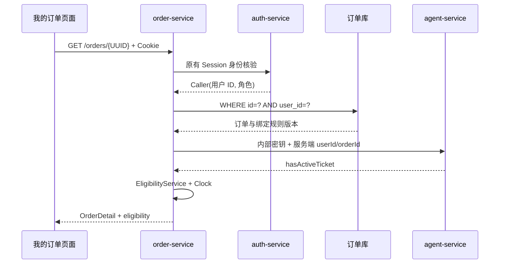

# S1 后端：商品、我的订单与售后资格——完整代码粘贴指南

日期：2026-11-18。适配当前 Java 21 / Spring Boot 4.0.8 多模块工程。

这份指南交付 B01 商品列表、B02 本人订单列表、B03 本人订单详情与售后资格，以及必要的内部活动工单查询。每份 Java 代码都是完整文件，不含省略号、TODO 或待补方法。业务源码由你按顺序粘贴；本目录 files 是供你查看与复制的文件副本，后端工程不会自动编译这里的 Java。

项目根目录：`A:/A_workSpace/AgentProjects/after-sales-agent`。

## 先知道最终会得到什么

| 接口                                                               | 权限与用途                                 |
| ---------------------------------------------------------------- | ------------------------------------- |
| GET /api/v1/products?page=1&size=20&category=EARPHONE            | 已登录；分类筛选、稳定分页                         |
| GET /api/v1/orders?page=1&size=20&orderNo=A1001&status=DELIVERED | CUSTOMER；仅本人订单，订单号精确匹配                |
| GET /api/v1/orders/{orderId}                                     | CUSTOMER；UUID 路径参数，本人详情、规则版本、售后资格     |
| GET /internal/tickets/active?userId=...&orderId=...              | 服务端专用密钥；仅检查 OPEN/PROCESSING 工单，不经网关公开 |

公开响应对齐 `after-sales-agent-spec/openapi.json`：列表为 `data.items/page/size/total`，金额为字符串，商品为嵌套对象。订单列表提供页面基础展示数据；详情才请求工单服务和计算资格，避免列表每一行各发一次远程请求。



## 粘贴顺序

1. 第一步：公共响应与异常（3 个 Java 文件）。
2. 第二步：Agent 内部查询（3 个 Java 文件）。
3. 第三步：订单服务（10 个 Java 文件）。
4. 第四步：依赖、配置和路由，按后面的精确片段修改。
5. 第五步：测试文件、测试资源和可复用验证脚本。
6. 第六步：需要演示数据时，在各自的开发库执行对应 SQL。

所有“替换”都指替换对应文件内容；“新增”指在目标包下创建该文件。无需修改原 V1 迁移，已有表结构已满足本轮功能。

## 为什么这样设计

**身份与数据归属是两道检查。** `@PreAuthorize` 限制谁能使用“我的订单”；SQL 中的 `user_id = :userId` 限制能读哪些行。ADMIN 即使登录也不能冒充客户查询；Alice 的请求中增加 userId=Bob 不会改变范围，因为 Controller 只使用认证得到的 Caller。不存在和不属于本人统一返回 404。

**用 Clock，是为了让时间规则可以重复测试。** 直接写 `LocalDate.now()` 会依赖机器默认时区和当天日期；测试在半年后可能变成另一种结果。生产使用系统时钟，测试传入 `Clock.fixed`。同一次资格计算只取一次 instant，再统一转换成上海日期，比较 `today.isAfter(eligibleUntil)`，所以边界当天仍有效。这与 [Java 21 Clock 官方文档](https://docs.oracle.com/en/java/javase/21/docs/api/java.base/java/time/Clock.html) 的可替换时钟用法一致。

**保修天数从订单绑定的规则读取。** 耳机 180 天、键盘 365 天属于模拟商店配置。查询按 `o.policy_rule_id = r.id` 连接规则版本，修改知识文档或新增 v2 不会改变旧订单。不要在资格服务中根据商品名称硬编码天数。

**跨服务使用小型只读 HTTP 契约。** ticket 表属于 Agent 库，所以 order-service 通过内部接口查询。当前项目已有 JDK HttpClient 和服务端密钥模式，沿用它可以复用连接与安全约定，无需增加另一套 RPC 框架。内部接口不接收客户 Cookie，也不把密钥返回页面。服务凭证复用现有 SERVICE_AUTH_TOKEN，它识别可信后端，并不区分具体是哪一个后端进程；当前只开放这一项只读能力。网关继续拒绝 /internal/。

**为什么需要第二条 SecurityFilterChain。** 原链把业务请求交给认证服务检查 Cookie。内部调用使用服务凭证，因此给 `/internal/tickets/**` 配置 `@Order(0)` 的专用链；其他路径继续进入原链。`securityMatcher` 决定整条链适用的路径，链内 `requestMatchers` 决定允许的具体方法和资源。过滤器只加入这条链，不声明为全局 Filter Bean，避免同一请求重复执行。参见 [Spring Security 多条安全链](https://docs.spring.io/spring-security/reference/servlet/configuration/java.html#_multiple_httpsecurity_instances)。

**超时或坏响应不能返回“没有活动工单”。** 工单服务失败、重定向、返回 `{}`、返回字符串 `"false"`，都会产生 503 / DEPENDENCY_UNAVAILABLE。只有明确收到 JSON 布尔值，才参与资格判断。这能避免上游故障时错误地展示“可申请”。HTTP 客户端设置了连接与请求超时，并在捕获 InterruptedException 后恢复中断标志，供线程池正确结束取消中的任务。

**分页 SQL 使用参数绑定。** 动态拼接的只有代码中固定的 WHERE 条件，用户输入全部通过命名参数传入，枚举限制分类和状态。`created_at DESC, id DESC` 在时间相同时仍有确定顺序。offset 使用 long，避免很大 page 与 size 相乘时 int 溢出。继续使用现有 JDBC 技术栈，便于看清 SQL 与归属约束。参见 [Spring JDBC 官方说明](https://docs.spring.io/spring-framework/reference/data-access/jdbc/core.html)。

**短事务与远程调用分开。** 每个列表的 count 和 items 在 PostgreSQL REPEATABLE_READ 短只读事务中共享快照，避免两条 SQL 之间新增订单导致 total 与 items 不一致。事务只包本地 SQL。详情查询结束后先释放数据库连接，再等待远程工单查询；在 OrderService.detail 上增加长事务并不能把两个服务变成原子事务。

**资格结果是查询时快照。** 用户读完详情后，工单或订单状态还可能变化。后续 S6 确认建单必须重新校验；Agent 库的 `uq_active_ticket_order` 唯一索引继续防止同一订单重复创建 OPEN/PROCESSING 工单。订单版本变化与本地提交之间的跨服务一致性协议需要在 S6 定义，本轮只读接口不声称解决它。

**record 和 DTO 的作用。** DTO 只公开页面需要的字段，避免把数据库行直接序列化；record 适合这种只读数据。相近的小型 DTO 统一放在 OrderDtos 中，缩短文件清单。若后续模块增大，可以再按类型拆成独立文件。价格在 Repository 用 BigDecimal 保留两位小数并转换成字符串，符合本项目接口契约。

## 第一步：公共响应与异常

原 ApiResponses.error 的 `detials` 拼写与 requestId 位置不符合契约，这里统一修正。现有前端 http.ts 同时支持顶层 requestId 和正式 details，因此可以接收新格式。

### 替换 ApiResponses.java

目标位置：`A:/A_workSpace/AgentProjects/after-sales-agent/backend/service-common/src/main/java/com/example/aftersales/common/ApiResponses.java`

统一成功与错误外壳；修正原 detials 拼写，将 requestId 放到顶层。现有前端已支持正式 details 字段。

完整文件也可从 [代码副本](A:/A_workSpace/AgentProjects/after-sales-agent/docs/S1-后端粘贴包/files/backend/service-common/src/main/java/com/example/aftersales/common/ApiResponses.java) 打开复制。

```java
package com.example.aftersales.common;

import jakarta.servlet.http.HttpServletRequest;
import java.util.Map;
import java.util.UUID;

public final class ApiResponses {
    private static final String REQUEST_ID = ApiResponses.class.getName();
    private ApiResponses() {}

    public static Map<String, Object> ok(Object data, HttpServletRequest request) {
        return Map.of("code", "OK", "message", "success", "data", data,
                "requestId", requestId(request));
    }

    public static Map<String, Object> error(String code, String message, HttpServletRequest request) {
        return Map.of("code", code, "message", message, "details", Map.of(),
                "requestId", requestId(request));
    }

    private static String requestId(HttpServletRequest request) {
        Object existing = request.getAttribute(REQUEST_ID);
        if (existing != null) return existing.toString();
        String value = UUID.randomUUID().toString();
        request.setAttribute(REQUEST_ID, value);
        return value;
    }
}
```

### 新增 ServiceApiException.java

目标位置：`A:/A_workSpace/AgentProjects/after-sales-agent/backend/service-common/src/main/java/com/example/aftersales/platform/ServiceApiException.java`

显式区分业务错误码与 HTTP 状态；对外消息由代码指定，避免泄露 SQL、令牌或上游响应。

完整文件也可从 [代码副本](A:/A_workSpace/AgentProjects/after-sales-agent/docs/S1-后端粘贴包/files/backend/service-common/src/main/java/com/example/aftersales/platform/ServiceApiException.java) 打开复制。

```java
package com.example.aftersales.platform;

import org.springframework.http.HttpStatus;

/** 这里只保存可以安全返回给客户的错误信息，不保存 SQL、凭证或上游响应体。 */
public class ServiceApiException extends RuntimeException {
    private final HttpStatus status;
    private final String code;

    public ServiceApiException(HttpStatus status, String code, String message) {
        super(message);
        this.status = status;
        this.code = code;
    }

    public HttpStatus status() { return status; }
    public String code() { return code; }
}
```

### 替换 ServiceExceptionHandler.java

目标位置：`A:/A_workSpace/AgentProjects/after-sales-agent/backend/service-common/src/main/java/com/example/aftersales/platform/ServiceExceptionHandler.java`

把订单不存在、依赖不可用、参数错误变成统一响应；保留原有 ResponseStatusException 支持。

完整文件也可从 [代码副本](A:/A_workSpace/AgentProjects/after-sales-agent/docs/S1-后端粘贴包/files/backend/service-common/src/main/java/com/example/aftersales/platform/ServiceExceptionHandler.java) 打开复制。

```java
package com.example.aftersales.platform;

import com.example.aftersales.common.ApiResponses;
import jakarta.servlet.http.HttpServletRequest;
import org.springframework.http.ResponseEntity;
import org.springframework.web.bind.MissingServletRequestParameterException;
import org.springframework.web.bind.annotation.ExceptionHandler;
import org.springframework.web.bind.annotation.RestControllerAdvice;
import org.springframework.web.method.annotation.MethodArgumentTypeMismatchException;
import org.springframework.web.server.ResponseStatusException;

@RestControllerAdvice
public class ServiceExceptionHandler {
    @ExceptionHandler(ServiceApiException.class)
    ResponseEntity<?> business(ServiceApiException exception, HttpServletRequest request) {
        return ResponseEntity.status(exception.status()).body(
                ApiResponses.error(exception.code(), exception.getMessage(), request));
    }

    @ExceptionHandler(ResponseStatusException.class)
    ResponseEntity<?> status(ResponseStatusException exception, HttpServletRequest request) {
        int status = exception.getStatusCode().value();
        return ResponseEntity.status(status).body(ApiResponses.error(
                status == 404 ? "NOT_FOUND" : "REQUEST_FAILED",
                "请求的资源不存在或不可用", request));
    }

    @ExceptionHandler({MethodArgumentTypeMismatchException.class, IllegalArgumentException.class,
            MissingServletRequestParameterException.class})
    ResponseEntity<?> invalid(Exception exception, HttpServletRequest request) {
        return ResponseEntity.badRequest().body(
                ApiResponses.error("VALIDATION_ERROR", "请检查请求参数", request));
    }
}
```

## 第二步：Agent 内部查询

### 新增 InternalTicketSecurityConfiguration.java

目标位置：`A:/A_workSpace/AgentProjects/after-sales-agent/backend/agent-service/src/main/java/com/example/aftersales/agent/InternalTicketSecurityConfiguration.java`

给 /internal/tickets/** 建立优先匹配的专用安全链；仅接受服务端密钥，只允许 GET /active。普通客户接口仍走原 Cookie 鉴权。

完整文件也可从 [代码副本](A:/A_workSpace/AgentProjects/after-sales-agent/docs/S1-后端粘贴包/files/backend/agent-service/src/main/java/com/example/aftersales/agent/InternalTicketSecurityConfiguration.java) 打开复制。

```java
package com.example.aftersales.agent;

import com.example.aftersales.common.ApiResponses;
import jakarta.servlet.FilterChain;
import jakarta.servlet.ServletException;
import jakarta.servlet.http.HttpServletRequest;
import jakarta.servlet.http.HttpServletResponse;
import org.springframework.beans.factory.annotation.Value;
import org.springframework.context.annotation.Bean;
import org.springframework.context.annotation.Configuration;
import org.springframework.core.annotation.Order;
import org.springframework.http.HttpMethod;
import org.springframework.security.authentication.UsernamePasswordAuthenticationToken;
import org.springframework.security.config.annotation.web.builders.HttpSecurity;
import org.springframework.security.config.http.SessionCreationPolicy;
import org.springframework.security.core.authority.SimpleGrantedAuthority;
import org.springframework.security.core.context.SecurityContextHolder;
import org.springframework.security.web.SecurityFilterChain;
import org.springframework.security.web.authentication.AnonymousAuthenticationFilter;
import org.springframework.web.filter.OncePerRequestFilter;
import tools.jackson.databind.ObjectMapper;
import java.io.IOException;
import java.nio.charset.StandardCharsets;
import java.security.MessageDigest;
import java.util.List;

@Configuration(proxyBeanMethods = false)
public class InternalTicketSecurityConfiguration {
    @Bean
    @Order(0)
    SecurityFilterChain internalTickets(HttpSecurity http, ObjectMapper json,
            @Value("${app.services.auth-token}") String serviceToken) throws Exception {
        if (serviceToken == null || serviceToken.length() < 32) {
            throw new IllegalArgumentException("Invalid SERVICE_AUTH_TOKEN");
        }
        byte[] expected = serviceToken.getBytes(StandardCharsets.UTF_8);
        // 仅添加到此安全链，不声明成 Filter Bean，避免被 Boot 再注册成全局过滤器。
        var tokenFilter = new OncePerRequestFilter() {
            @Override
            protected void doFilterInternal(HttpServletRequest request, HttpServletResponse response,
                    FilterChain chain) throws IOException, ServletException {
                String token = request.getHeader("X-Service-Token");
                if (token == null || !MessageDigest.isEqual(expected, token.getBytes(StandardCharsets.UTF_8))) {
                    response.setStatus(401);
                    response.setContentType("application/json");
                    response.setCharacterEncoding("UTF-8");
                    json.writeValue(response.getWriter(), ApiResponses.error(
                            "UNAUTHENTICATED", "服务身份校验失败", request));
                    return;
                }
                var context = SecurityContextHolder.createEmptyContext();
                context.setAuthentication(UsernamePasswordAuthenticationToken.authenticated(
                        "internal-service", null, List.of(new SimpleGrantedAuthority("TICKET_QUERY"))));
                SecurityContextHolder.setContext(context);
                try { chain.doFilter(request, response); }
                finally { SecurityContextHolder.clearContext(); }
            }
        };
        return http.securityMatcher("/internal/tickets/**")
                .csrf(csrf -> csrf.disable())
                .sessionManagement(s -> s.sessionCreationPolicy(SessionCreationPolicy.STATELESS))
                .formLogin(f -> f.disable()).httpBasic(b -> b.disable())
                .logout(l -> l.disable()).requestCache(c -> c.disable())
                .addFilterBefore(tokenFilter, AnonymousAuthenticationFilter.class)
                .authorizeHttpRequests(a -> a
                        .requestMatchers(HttpMethod.GET, "/internal/tickets/active").hasAuthority("TICKET_QUERY")
                        .anyRequest().denyAll())
                .exceptionHandling(e -> e.accessDeniedHandler((request, response, exception) -> {
                    response.setStatus(403);
                    response.setContentType("application/json");
                    response.setCharacterEncoding("UTF-8");
                    json.writeValue(response.getWriter(), ApiResponses.error("FORBIDDEN", "没有访问权限", request));
                })).build();
    }
}
```

### 新增 ActiveTicketRepository.java

目标位置：`A:/A_workSpace/AgentProjects/after-sales-agent/backend/agent-service/src/main/java/com/example/aftersales/agent/ActiveTicketRepository.java`

用 SELECT EXISTS 读取本人订单的 OPEN/PROCESSING 工单，不加载整张工单，也不返回描述或管理员备注。

完整文件也可从 [代码副本](A:/A_workSpace/AgentProjects/after-sales-agent/docs/S1-后端粘贴包/files/backend/agent-service/src/main/java/com/example/aftersales/agent/ActiveTicketRepository.java) 打开复制。

```java
package com.example.aftersales.agent;

import org.springframework.jdbc.core.namedparam.NamedParameterJdbcTemplate;
import org.springframework.stereotype.Repository;
import java.util.Map;
import java.util.UUID;

@Repository
public class ActiveTicketRepository {
    private final NamedParameterJdbcTemplate jdbc;
    public ActiveTicketRepository(NamedParameterJdbcTemplate jdbc) { this.jdbc = jdbc; }

    public boolean exists(UUID userId, UUID orderId) {
        return Boolean.TRUE.equals(jdbc.queryForObject("""
                SELECT EXISTS (
                    SELECT 1 FROM ticket
                    WHERE user_id = :userId AND order_id = :orderId
                      AND status IN ('OPEN', 'PROCESSING')
                )
                """, Map.of("userId", userId, "orderId", orderId), Boolean.class));
    }
}
```

### 新增 InternalTicketController.java

目标位置：`A:/A_workSpace/AgentProjects/after-sales-agent/backend/agent-service/src/main/java/com/example/aftersales/agent/InternalTicketController.java`

内部服务契约只有一个布尔字段。这里的 userId 是受信后端传入的上下文；公开订单接口始终从 Caller 取当前用户。

完整文件也可从 [代码副本](A:/A_workSpace/AgentProjects/after-sales-agent/docs/S1-后端粘贴包/files/backend/agent-service/src/main/java/com/example/aftersales/agent/InternalTicketController.java) 打开复制。

```java
package com.example.aftersales.agent;

import org.springframework.web.bind.annotation.*;
import java.util.UUID;

@RestController
@RequestMapping("/internal/tickets")
public class InternalTicketController {
    private final ActiveTicketRepository tickets;
    public InternalTicketController(ActiveTicketRepository tickets) { this.tickets = tickets; }

    @GetMapping("/active")
    public ActiveTicketView active(@RequestParam UUID userId, @RequestParam UUID orderId) {
        return new ActiveTicketView(tickets.exists(userId, orderId));
    }

    public record ActiveTicketView(boolean hasActiveTicket) {}
}
```

## 第三步：商品与订单服务

### 新增 OrderDtos.java

目标位置：`A:/A_workSpace/AgentProjects/after-sales-agent/backend/order-service/src/main/java/com/example/aftersales/order/OrderDtos.java`

固定接口结构、枚举与分页参数。DTO 里的 price 是两位小数字符串，取消订单的 deliveredAt 和 eligibleUntil 可以为空。

完整文件也可从 [代码副本](A:/A_workSpace/AgentProjects/after-sales-agent/docs/S1-后端粘贴包/files/backend/order-service/src/main/java/com/example/aftersales/order/OrderDtos.java) 打开复制。

```java
package com.example.aftersales.order;

import java.time.LocalDate;
import java.time.OffsetDateTime;
import java.util.List;
import java.util.UUID;

/** 将小型只读 DTO 放在一起；public record 隐式为 static，不持有外部对象。 */
public final class OrderDtos {
    private OrderDtos() {}

    public enum ProductCategory { EARPHONE, KEYBOARD }
    public enum OrderStatus { DELIVERED, CANCELED }

    public record PageQuery(int page, int size) {
        public PageQuery {
            if (page < 1 || size < 1 || size > 100) {
                throw new IllegalArgumentException("page >= 1; size between 1 and 100");
            }
        }
        public long offset() { return ((long) page - 1) * size; }
    }

    public record PageData<T>(List<T> items, int page, int size, long total) {
        public PageData { items = List.copyOf(items); }
    }

    public record Product(UUID id, String sku, String name, ProductCategory category) {}

    public record OrderSummary(UUID id, String orderNo, Product product, OrderStatus status,
                               String price, OffsetDateTime deliveredAt) {}

    public record Eligibility(boolean eligible, List<String> reasonCodes, LocalDate eligibleUntil,
                              OffsetDateTime evaluatedAt, long ruleVersion) {
        public Eligibility { reasonCodes = List.copyOf(reasonCodes); }
    }

    public record OrderDetail(UUID id, String orderNo, Product product, OrderStatus status,
                              String price, OffsetDateTime deliveredAt, UUID policyRuleId,
                              long policyVersion, Eligibility eligibility) {}
}
```

### 新增 ProductRepository.java

目标位置：`A:/A_workSpace/AgentProjects/after-sales-agent/backend/order-service/src/main/java/com/example/aftersales/order/ProductRepository.java`

商品分页及分类筛选；count 和列表在短只读事务中读取同一个数据库快照。

完整文件也可从 [代码副本](A:/A_workSpace/AgentProjects/after-sales-agent/docs/S1-后端粘贴包/files/backend/order-service/src/main/java/com/example/aftersales/order/ProductRepository.java) 打开复制。

```java
package com.example.aftersales.order;

import org.springframework.jdbc.core.namedparam.MapSqlParameterSource;
import org.springframework.jdbc.core.namedparam.NamedParameterJdbcTemplate;
import org.springframework.stereotype.Repository;
import org.springframework.transaction.annotation.Isolation;
import org.springframework.transaction.annotation.Transactional;
import java.util.UUID;
import static com.example.aftersales.order.OrderDtos.*;

@Repository
public class ProductRepository {
    private final NamedParameterJdbcTemplate jdbc;
    public ProductRepository(NamedParameterJdbcTemplate jdbc) { this.jdbc = jdbc; }

    // count 和 items 使用同一数据库快照；事务只覆盖两条本地 SQL。
    @Transactional(readOnly = true, isolation = Isolation.REPEATABLE_READ)
    public PageData<Product> list(PageQuery page, ProductCategory category) {
        String where = category == null ? "" : " WHERE category = :category";
        var args = new MapSqlParameterSource()
                .addValue("limit", page.size()).addValue("offset", page.offset());
        if (category != null) args.addValue("category", category.name());
        long total = jdbc.queryForObject("SELECT count(*) FROM product" + where, args, Long.class);
        var items = jdbc.query("""
                SELECT id, sku, name, category FROM product
                """ + where + " ORDER BY created_at DESC, id DESC LIMIT :limit OFFSET :offset",
                args, (rs, n) -> new Product(rs.getObject("id", UUID.class), rs.getString("sku"),
                        rs.getString("name"), ProductCategory.valueOf(rs.getString("category"))));
        return new PageData<>(items, page.page(), page.size(), total);
    }
}
```

### 新增 OrderRepository.java

目标位置：`A:/A_workSpace/AgentProjects/after-sales-agent/backend/order-service/src/main/java/com/example/aftersales/order/OrderRepository.java`

所有订单 SQL 都绑定 userId；按订单已绑定的 policy_rule_id 取不可变版本，不查询“最新政策”。数据库快照与对外 DTO 分开。

完整文件也可从 [代码副本](A:/A_workSpace/AgentProjects/after-sales-agent/docs/S1-后端粘贴包/files/backend/order-service/src/main/java/com/example/aftersales/order/OrderRepository.java) 打开复制。

```java
package com.example.aftersales.order;

import org.springframework.jdbc.core.RowMapper;
import org.springframework.jdbc.core.namedparam.MapSqlParameterSource;
import org.springframework.jdbc.core.namedparam.NamedParameterJdbcTemplate;
import org.springframework.stereotype.Repository;
import org.springframework.transaction.annotation.Isolation;
import org.springframework.transaction.annotation.Transactional;
import java.math.RoundingMode;
import java.time.OffsetDateTime;
import java.util.Map;
import java.util.Optional;
import java.util.UUID;
import static com.example.aftersales.order.OrderDtos.*;

@Repository
public class OrderRepository {
    private static final String FROM = """
            FROM customer_order o
            JOIN product p ON p.id = o.product_id
            JOIN policy_rule r ON r.id = o.policy_rule_id
            """;
    private static final String SELECT = """
            SELECT o.id, o.order_no, o.status, o.price, o.delivered_at,
                   o.policy_rule_id, r.version AS rule_version, r.warranty_days,
                   p.id AS product_id, p.sku, p.name, p.category
            """ + FROM;
    private static final RowMapper<OrderSnapshot> MAPPER = (rs, n) -> new OrderSnapshot(
            rs.getObject("id", UUID.class), rs.getString("order_no"),
            new Product(rs.getObject("product_id", UUID.class), rs.getString("sku"),
                    rs.getString("name"), ProductCategory.valueOf(rs.getString("category"))),
            OrderStatus.valueOf(rs.getString("status")),
            rs.getBigDecimal("price").setScale(2, RoundingMode.UNNECESSARY).toPlainString(),
            rs.getObject("delivered_at", OffsetDateTime.class),
            rs.getObject("policy_rule_id", UUID.class), rs.getLong("rule_version"),
            rs.getInt("warranty_days"));

    private final NamedParameterJdbcTemplate jdbc;
    public OrderRepository(NamedParameterJdbcTemplate jdbc) { this.jdbc = jdbc; }

    @Transactional(readOnly = true, isolation = Isolation.REPEATABLE_READ)
    public PageData<OrderSummary> listOwned(UUID userId, PageQuery page,
                                            String orderNo, OrderStatus status) {
        StringBuilder where = new StringBuilder(" WHERE o.user_id = :userId");
        var args = new MapSqlParameterSource("userId", userId)
                .addValue("limit", page.size()).addValue("offset", page.offset());
        if (orderNo != null) {
            where.append(" AND o.order_no = :orderNo");
            args.addValue("orderNo", orderNo);
        }
        if (status != null) {
            where.append(" AND o.status = :status");
            args.addValue("status", status.name());
        }
        long total = jdbc.queryForObject("SELECT count(*) " + FROM + where, args, Long.class);
        var items = jdbc.query(SELECT + where
                + " ORDER BY o.created_at DESC, o.id DESC LIMIT :limit OFFSET :offset", args, MAPPER)
                .stream().map(OrderSnapshot::summary).toList();
        return new PageData<>(items, page.page(), page.size(), total);
    }

    public Optional<OrderSnapshot> findOwned(UUID userId, UUID orderId) {
        return jdbc.query(SELECT + " WHERE o.id = :orderId AND o.user_id = :userId",
                Map.of("orderId", orderId, "userId", userId), MAPPER).stream().findFirst();
    }

    /** 数据库查询快照，不作为接口响应直接序列化。 */
    public record OrderSnapshot(UUID id, String orderNo, Product product, OrderStatus status,
                                String price, OffsetDateTime deliveredAt, UUID policyRuleId,
                                long ruleVersion, int warrantyDays) {
        public OrderSummary summary() {
            return new OrderSummary(id, orderNo, product, status, price, deliveredAt);
        }
    }
}
```

### 新增 OrderClockConfiguration.java

目标位置：`A:/A_workSpace/AgentProjects/after-sales-agent/backend/order-service/src/main/java/com/example/aftersales/order/OrderClockConfiguration.java`

提供上海业务时区的 Clock Bean；测试可以直接传入固定 Clock。

完整文件也可从 [代码副本](A:/A_workSpace/AgentProjects/after-sales-agent/docs/S1-后端粘贴包/files/backend/order-service/src/main/java/com/example/aftersales/order/OrderClockConfiguration.java) 打开复制。

```java
package com.example.aftersales.order;

import org.springframework.context.annotation.Bean;
import org.springframework.context.annotation.Configuration;
import java.time.Clock;
import java.time.ZoneId;

@Configuration(proxyBeanMethods = false)
public class OrderClockConfiguration {
    public static final ZoneId BUSINESS_ZONE = ZoneId.of("Asia/Shanghai");
    @Bean
    Clock businessClock() { return Clock.system(BUSINESS_ZONE); }
}
```

### 新增 EligibilityService.java

目标位置：`A:/A_workSpace/AgentProjects/after-sales-agent/backend/order-service/src/main/java/com/example/aftersales/order/EligibilityService.java`

纯 Java 规则计算：已签收、期限最后一天包含在内、没有活动工单。模型不参与这些判定。

完整文件也可从 [代码副本](A:/A_workSpace/AgentProjects/after-sales-agent/docs/S1-后端粘贴包/files/backend/order-service/src/main/java/com/example/aftersales/order/EligibilityService.java) 打开复制。

```java
package com.example.aftersales.order;

import org.springframework.stereotype.Service;
import java.time.Clock;
import java.time.LocalDate;
import java.util.ArrayList;
import java.util.Objects;
import static com.example.aftersales.order.OrderClockConfiguration.BUSINESS_ZONE;
import static com.example.aftersales.order.OrderDtos.*;
import static com.example.aftersales.order.OrderRepository.OrderSnapshot;

@Service
public class EligibilityService {
    private final Clock clock;
    public EligibilityService(Clock clock) { this.clock = clock; }

    public Eligibility evaluate(OrderSnapshot order, boolean hasActiveTicket) {
        // 一次计算只读取一次当前时间，避免恰好跨零点时产生矛盾结果。
        var evaluatedAt = clock.instant().atZone(BUSINESS_ZONE).toOffsetDateTime();
        LocalDate today = evaluatedAt.toLocalDate();
        LocalDate eligibleUntil = null;
        var reasons = new ArrayList<String>();
        if (order.status() == OrderStatus.CANCELED) {
            reasons.add("ORDER_CANCELED");
        } else {
            var deliveredAt = Objects.requireNonNull(order.deliveredAt(), "Delivered order needs date");
            eligibleUntil = deliveredAt.atZoneSameInstant(BUSINESS_ZONE)
                    .toLocalDate().plusDays(order.warrantyDays());
            if (today.isAfter(eligibleUntil)) reasons.add("WARRANTY_EXPIRED");
        }
        if (hasActiveTicket) reasons.add("ACTIVE_TICKET_EXISTS");
        return new Eligibility(reasons.isEmpty(), reasons, eligibleUntil, evaluatedAt, order.ruleVersion());
    }
}
```

### 新增 ActiveTicketClient.java

目标位置：`A:/A_workSpace/AgentProjects/after-sales-agent/backend/order-service/src/main/java/com/example/aftersales/order/ActiveTicketClient.java`

请求工单服务，连接超时 1 秒、请求超时 3 秒，禁止重定向，严格检查布尔返回值；失败返回 503，恢复线程中断标志。

完整文件也可从 [代码副本](A:/A_workSpace/AgentProjects/after-sales-agent/docs/S1-后端粘贴包/files/backend/order-service/src/main/java/com/example/aftersales/order/ActiveTicketClient.java) 打开复制。

```java
package com.example.aftersales.order;

import com.example.aftersales.platform.ServiceApiException;
import org.springframework.beans.factory.annotation.Value;
import org.springframework.http.HttpStatus;
import org.springframework.stereotype.Component;
import tools.jackson.databind.ObjectMapper;
import java.io.IOException;
import java.net.URI;
import java.net.http.HttpClient;
import java.net.http.HttpRequest;
import java.net.http.HttpResponse;
import java.time.Duration;
import java.util.Set;
import java.util.UUID;

@Component
public class ActiveTicketClient {
    private final URI origin;
    private final String token;
    private final ObjectMapper json;
    private final HttpClient client = HttpClient.newBuilder()
            .connectTimeout(Duration.ofSeconds(1))
            .followRedirects(HttpClient.Redirect.NEVER).build();

    public ActiveTicketClient(@Value("${app.services.agent-url}") String agentUrl,
                              @Value("${app.services.auth-token}") String token,
                              ObjectMapper json) {
        origin = URI.create(agentUrl);
        if (!Set.of("http", "https").contains(origin.getScheme()) || origin.getHost() == null
                || origin.getUserInfo() != null || origin.getQuery() != null || origin.getFragment() != null
                || !(origin.getPath().isEmpty() || "/".equals(origin.getPath()))) {
            throw new IllegalArgumentException("AGENT_SERVICE_URL must be an HTTP(S) origin");
        }
        if (token == null || token.length() < 32 || token.contains("\r") || token.contains("\n")) {
            throw new IllegalArgumentException("Invalid SERVICE_AUTH_TOKEN");
        }
        this.token = token;
        this.json = json;
    }

    public boolean exists(UUID userId, UUID orderId) {
        URI endpoint = origin.resolve("/internal/tickets/active?userId=" + userId + "&orderId=" + orderId);
        var request = HttpRequest.newBuilder(endpoint).timeout(Duration.ofSeconds(3))
                .header("Accept", "application/json").header("X-Service-Token", token).GET().build();
        HttpResponse<String> response;
        try {
            response = client.send(request, HttpResponse.BodyHandlers.ofString());
        } catch (InterruptedException exception) {
            Thread.currentThread().interrupt();
            throw unavailable();
        } catch (IOException exception) {
            throw unavailable();
        }
        if (response.statusCode() != 200) throw unavailable();
        try {
            var body = json.readTree(response.body());
            if (body == null || !body.isObject() || !body.path("hasActiveTicket").isBoolean()) {
                throw unavailable();
            }
            return body.path("hasActiveTicket").asBoolean();
        } catch (ServiceApiException exception) {
            throw exception;
        } catch (RuntimeException exception) {
            throw unavailable();
        }
    }

    private ServiceApiException unavailable() {
        return new ServiceApiException(HttpStatus.SERVICE_UNAVAILABLE,
                "DEPENDENCY_UNAVAILABLE", "暂时无法核验活动工单，请稍后重试");
    }
}
```

### 新增 OrderService.java

目标位置：`A:/A_workSpace/AgentProjects/after-sales-agent/backend/order-service/src/main/java/com/example/aftersales/order/OrderService.java`

先验证订单归属，再查活动工单，最后组合详情。远程调用不占用本地数据库事务。

完整文件也可从 [代码副本](A:/A_workSpace/AgentProjects/after-sales-agent/docs/S1-后端粘贴包/files/backend/order-service/src/main/java/com/example/aftersales/order/OrderService.java) 打开复制。

```java
package com.example.aftersales.order;

import com.example.aftersales.platform.ServiceApiException;
import org.springframework.http.HttpStatus;
import org.springframework.stereotype.Service;
import java.util.UUID;
import static com.example.aftersales.order.OrderDtos.*;

@Service
public class OrderService {
    private final OrderRepository orders;
    private final EligibilityService eligibility;
    private final ActiveTicketClient tickets;

    public OrderService(OrderRepository orders, EligibilityService eligibility, ActiveTicketClient tickets) {
        this.orders = orders;
        this.eligibility = eligibility;
        this.tickets = tickets;
    }

    public PageData<OrderSummary> list(UUID userId, PageQuery page, String orderNo, OrderStatus status) {
        if (orderNo != null) {
            orderNo = orderNo.strip();
            if (orderNo.isEmpty() || orderNo.length() > 64) {
                throw new IllegalArgumentException("Invalid orderNo");
            }
        }
        return orders.listOwned(userId, page, orderNo, status);
    }

    // 不加 @Transactional：本地查询结束后，再请求工单服务，不长期占用数据库连接。
    public OrderDetail detail(UUID userId, UUID orderId) {
        var order = orders.findOwned(userId, orderId).orElseThrow(() -> new ServiceApiException(
                HttpStatus.NOT_FOUND, "ORDER_NOT_FOUND", "未找到可访问的订单"));
        boolean active = tickets.exists(userId, order.id());
        var result = eligibility.evaluate(order, active);
        return new OrderDetail(order.id(), order.orderNo(), order.product(), order.status(), order.price(),
                order.deliveredAt(), order.policyRuleId(), order.ruleVersion(), result);
    }
}
```

### 新增 ProductController.java

目标位置：`A:/A_workSpace/AgentProjects/after-sales-agent/backend/order-service/src/main/java/com/example/aftersales/order/ProductController.java`

商品列表是纯读取，直接使用 Repository；订单详情需要规则与远程状态组合，所以由 OrderService 承担编排。

完整文件也可从 [代码副本](A:/A_workSpace/AgentProjects/after-sales-agent/docs/S1-后端粘贴包/files/backend/order-service/src/main/java/com/example/aftersales/order/ProductController.java) 打开复制。

```java
package com.example.aftersales.order;

import com.example.aftersales.common.ApiResponses;
import jakarta.servlet.http.HttpServletRequest;
import org.springframework.web.bind.annotation.*;
import java.util.Map;
import static com.example.aftersales.order.OrderDtos.*;

@RestController
@RequestMapping("/api/v1/products")
public class ProductController {
    private final ProductRepository products;
    public ProductController(ProductRepository products) { this.products = products; }

    @GetMapping
    public Map<String, Object> list(@RequestParam(defaultValue = "1") int page,
            @RequestParam(defaultValue = "20") int size,
            @RequestParam(required = false) ProductCategory category, HttpServletRequest request) {
        return ApiResponses.ok(products.list(new PageQuery(page, size), category), request);
    }
}
```

### 替换 OrderController.java

目标位置：`A:/A_workSpace/AgentProjects/after-sales-agent/backend/order-service/src/main/java/com/example/aftersales/order/OrderController.java`

替换原 Controller。CUSTOMER 才能访问“我的订单”，服务端 Caller 决定数据范围。

完整文件也可从 [代码副本](A:/A_workSpace/AgentProjects/after-sales-agent/docs/S1-后端粘贴包/files/backend/order-service/src/main/java/com/example/aftersales/order/OrderController.java) 打开复制。

```java
package com.example.aftersales.order;

import com.example.aftersales.common.ApiResponses;
import com.example.aftersales.platform.Caller;
import jakarta.servlet.http.HttpServletRequest;
import org.springframework.security.access.prepost.PreAuthorize;
import org.springframework.security.core.annotation.AuthenticationPrincipal;
import org.springframework.web.bind.annotation.*;
import java.util.Map;
import java.util.UUID;
import static com.example.aftersales.order.OrderDtos.*;

@RestController
@RequestMapping("/api/v1/orders")
@PreAuthorize("hasRole('CUSTOMER')")
public class OrderController {
    private final OrderService orders;
    public OrderController(OrderService orders) { this.orders = orders; }

    @GetMapping
    public Map<String, Object> list(@AuthenticationPrincipal Caller caller,
            @RequestParam(defaultValue = "1") int page, @RequestParam(defaultValue = "20") int size,
            @RequestParam(required = false) String orderNo,
            @RequestParam(required = false) OrderStatus status, HttpServletRequest request) {
        return ApiResponses.ok(orders.list(caller.id(), new PageQuery(page, size), orderNo, status), request);
    }

    @GetMapping("/{orderId}")
    public Map<String, Object> detail(@PathVariable UUID orderId,
            @AuthenticationPrincipal Caller caller, HttpServletRequest request) {
        return ApiResponses.ok(orders.detail(caller.id(), orderId), request);
    }
}
```

### 新增 OrderDatabaseExceptionHandler.java

目标位置：`A:/A_workSpace/AgentProjects/after-sales-agent/backend/order-service/src/main/java/com/example/aftersales/order/OrderDatabaseExceptionHandler.java`

只把数据库连接、超时、无法开启事务这类可用性问题映射为 503；SQL 程序错误仍作为服务器错误暴露给开发者排查。

完整文件也可从 [代码副本](A:/A_workSpace/AgentProjects/after-sales-agent/docs/S1-后端粘贴包/files/backend/order-service/src/main/java/com/example/aftersales/order/OrderDatabaseExceptionHandler.java) 打开复制。

```java
package com.example.aftersales.order;

import com.example.aftersales.common.ApiResponses;
import jakarta.servlet.http.HttpServletRequest;
import org.springframework.core.annotation.Order;
import org.springframework.dao.DataAccessResourceFailureException;
import org.springframework.dao.QueryTimeoutException;
import org.springframework.http.ResponseEntity;
import org.springframework.transaction.CannotCreateTransactionException;
import org.springframework.web.bind.annotation.ExceptionHandler;
import org.springframework.web.bind.annotation.RestControllerAdvice;

@Order(0)
@RestControllerAdvice(basePackageClasses = OrderController.class)
public class OrderDatabaseExceptionHandler {
    @ExceptionHandler({DataAccessResourceFailureException.class, QueryTimeoutException.class,
            CannotCreateTransactionException.class})
    ResponseEntity<?> unavailable(Exception exception, HttpServletRequest request) {
        return ResponseEntity.status(503).body(ApiResponses.error(
                "DEPENDENCY_UNAVAILABLE", "订单数据库暂不可用，请稍后重试", request));
    }
}
```

## 第四步：依赖、配置与路由

### 1. 两个 pom.xml 只增加测试依赖

位置：

- `A:/A_workSpace/AgentProjects/after-sales-agent/backend/order-service/pom.xml`
- `A:/A_workSpace/AgentProjects/after-sales-agent/backend/agent-service/pom.xml`

在各自已有 `<dependencies>` 中各加入一次：

```xml
<dependency>
    <groupId>org.springframework.security</groupId>
    <artifactId>spring-security-test</artifactId>
    <scope>test</scope>
</dependency>
```

版本由现有 Spring Boot BOM 管理。生产代码不需要新增依赖，原有 JDBC、Security、Jackson 3 已经足够。注意当前工程 ObjectMapper 的包是 `tools.jackson.databind`。

### 2. order-service/application.yml：新增工单服务地址

位置：`A:/A_workSpace/AgentProjects/after-sales-agent/backend/order-service/src/main/resources/application.yml`

找到已有 `app.services`，保持同一层级，修改为：

```yaml
app:
  services:
    auth-url: "${AUTH_SERVICE_URL:http://127.0.0.1:8081}"
    auth-token: "${SERVICE_AUTH_TOKEN:}"
    agent-url: "${AGENT_SERVICE_URL:http://127.0.0.1:8084}"
```

这是修改已有 app 块，不要在文件尾部另写第二个 app。IDE 本机启动默认访问 8084；agent-service 的现有配置和共享安全配置不需要修改。

### 3. compose.yaml：容器内使用服务名

位置：`A:/A_workSpace/AgentProjects/after-sales-agent/compose.yaml`

在 `services.order-service.environment` 原有配置中加入：

```yaml
      AGENT_SERVICE_URL: http://agent-service:8080
```

容器里的 127.0.0.1 指向该容器自身。Compose 用服务名查找 Agent 容器，内部端口为 8080；本机 IDE 的 8084 与容器端口属于不同访问方式。原 `SERVICE_AUTH_TOKEN` 已由公共环境配置传入各服务，两侧必须保持一致。

### 4. Nginx：把商品请求转给订单服务

位置：`A:/A_workSpace/AgentProjects/after-sales-agent/deploy/microservices/nginx.conf`

把原来的：

```nginx
location ~ ^/api/v1/orders(?:/|$) { proxy_pass $orders$request_uri; }
```

替换为：

```nginx
location ~ ^/api/v1/(products|orders)(?:/|$) { proxy_pass $orders$request_uri; }
```

保留原有 `location ^~ /internal/ { return 404; }`，内部查询由订单服务直连 Agent。

### 5. Vite：补开发代理

位置：`A:/A_workSpace/AgentProjects/after-sales-agent/frontend/vite.config.ts`

在 `direct ? { ... }` 的 `/api/v1/orders` 前新增一行：

```typescript
'/api/v1/products': rule('http://127.0.0.1:8082'),
```

这项只修改开发请求转发，没有新增页面组件。未加这条规则时，direct 模式的商品请求会落入 `/api` 默认代理并被送到 Agent。通过网关访问时由上面的 Nginx 规则负责转发。修改后重启 Vite；Docker 方式需重建相关镜像并重启网关。

上述 6 个文件在 files 中均有基于当前版本生成的完整副本；保留你之后新增的本地配置时，优先按本节片段合并。

## 第五步：测试文件与验证脚本

普通 Maven verify 会运行规则与 HTTP 客户端测试；两个 PostgreSQL 集成测试类要求专用环境变量，未提供时会跳过。下面的 Python 脚本会自动创建独立 PostgreSQL 集群、两个测试库并设置这两个变量；不要手工把它们指向开发数据库。集成测试中的 s1tester 是脚本临时集群的用户，与开发账号无关。

脚本验证身份边界时使用 HTTP 身份 stub；真实 Cookie Session 登录与 Redis 的验证属于现有 auth-service 测试和整栈联调。

### 新增 EligibilityServiceTest.java

目标位置：`A:/A_workSpace/AgentProjects/after-sales-agent/backend/order-service/src/test/java/com/example/aftersales/order/EligibilityServiceTest.java`

固定时钟测试：180/365 天边界、取消、活动工单、上海与 UTC 日期差异、规则版本。

```java
package com.example.aftersales.order;

import org.junit.jupiter.api.Test;
import java.time.*;
import java.util.UUID;
import static com.example.aftersales.order.OrderDtos.*;
import static com.example.aftersales.order.OrderRepository.OrderSnapshot;
import static org.junit.jupiter.api.Assertions.*;

class EligibilityServiceTest {
    private final Clock clock = Clock.fixed(Instant.parse("2026-11-18T02:00:00Z"), ZoneOffset.UTC);
    private final EligibilityService service = new EligibilityService(clock);

    private OrderSnapshot order(int daysAgo, int warrantyDays, OrderStatus status) {
        var date = LocalDate.of(2026, 11, 18).minusDays(daysAgo).atTime(10, 0).atOffset(ZoneOffset.ofHours(8));
        return new OrderSnapshot(UUID.randomUUID(), "TEST", null, status, "299.00",
                status == OrderStatus.CANCELED ? null : date, UUID.randomUUID(), 7, warrantyDays);
    }

    @Test void earphoneBoundaryDayIsIncluded() {
        var result = service.evaluate(order(180, 180, OrderStatus.DELIVERED), false);
        assertTrue(result.eligible());
        assertEquals(LocalDate.of(2026, 11, 18), result.eligibleUntil());
        assertEquals(7, result.ruleVersion());
    }
    @Test void oneDayOutsideBoundaryIsExpired() {
        var result = service.evaluate(order(181, 180, OrderStatus.DELIVERED), false);
        assertFalse(result.eligible());
        assertEquals(java.util.List.of("WARRANTY_EXPIRED"), result.reasonCodes());
    }
    @Test void keyboardUsesItsOwnWarrantyDays() {
        assertTrue(service.evaluate(order(365, 365, OrderStatus.DELIVERED), false).eligible());
        assertFalse(service.evaluate(order(366, 365, OrderStatus.DELIVERED), false).eligible());
    }
    @Test void canceledOrderDoesNotNeedDeliveryDate() {
        var result = service.evaluate(order(0, 180, OrderStatus.CANCELED), false);
        assertFalse(result.eligible());
        assertNull(result.eligibleUntil());
        assertEquals(java.util.List.of("ORDER_CANCELED"), result.reasonCodes());
    }
    @Test void activeTicketBlocksOtherwiseEligibleOrder() {
        var result = service.evaluate(order(30, 180, OrderStatus.DELIVERED), true);
        assertFalse(result.eligible());
        assertEquals(java.util.List.of("ACTIVE_TICKET_EXISTS"), result.reasonCodes());
    }
    @Test void expiredOrderCanAlsoHaveAnActiveTicket() {
        var result = service.evaluate(order(181, 180, OrderStatus.DELIVERED), true);
        assertEquals(java.util.List.of("WARRANTY_EXPIRED", "ACTIVE_TICKET_EXISTS"), result.reasonCodes());
    }
    @Test void deliveryDateUsesShanghaiDateRatherThanUtcDate() {
        var base = order(180, 180, OrderStatus.DELIVERED);
        var crossingMidnight = new OrderSnapshot(base.id(), base.orderNo(), null, base.status(), base.price(),
                OffsetDateTime.parse("2026-05-21T23:30:00Z"), base.policyRuleId(), 7, 180);
        // 该时刻在上海已经是 5 月 22 日，加 180 天为 11 月 18 日。
        assertTrue(service.evaluate(crossingMidnight, false).eligible());
        assertEquals(LocalDate.of(2026, 11, 18), service.evaluate(crossingMidnight, false).eligibleUntil());
    }
}
```

### 新增 OrderServiceTest.java

目标位置：`A:/A_workSpace/AgentProjects/after-sales-agent/backend/order-service/src/test/java/com/example/aftersales/order/OrderServiceTest.java`

订单不可访问时不请求工单服务；分页大整数计算、非法订单号校验。

```java
package com.example.aftersales.order;

import com.example.aftersales.platform.ServiceApiException;
import org.junit.jupiter.api.Test;
import java.util.Optional;
import java.util.UUID;
import static com.example.aftersales.order.OrderDtos.*;
import static org.junit.jupiter.api.Assertions.*;
import static org.mockito.Mockito.*;

class OrderServiceTest {
    private final OrderRepository orders = mock(OrderRepository.class);
    private final EligibilityService eligibility = mock(EligibilityService.class);
    private final ActiveTicketClient tickets = mock(ActiveTicketClient.class);
    private final OrderService service = new OrderService(orders, eligibility, tickets);

    @Test void inaccessibleOrderStopsBeforeRemoteQuery() {
        UUID alice = UUID.randomUUID(), otherOrder = UUID.randomUUID();
        when(orders.findOwned(alice, otherOrder)).thenReturn(Optional.empty());
        var error = assertThrows(ServiceApiException.class, () -> service.detail(alice, otherOrder));
        assertEquals("ORDER_NOT_FOUND", error.code());
        verifyNoInteractions(tickets, eligibility);
    }
    @Test void blankOrOverlongOrderNumberIsRejected() {
        assertThrows(IllegalArgumentException.class, () -> service.list(UUID.randomUUID(), new PageQuery(1, 20), "  ", null));
        assertThrows(IllegalArgumentException.class, () -> service.list(UUID.randomUUID(), new PageQuery(1, 20), "x".repeat(65), null));
        verifyNoInteractions(orders);
    }
    @Test void paginationCannotOverflowAnInt() {
        assertEquals(214748364600L, new PageQuery(Integer.MAX_VALUE, 100).offset());
        assertThrows(IllegalArgumentException.class, () -> new PageQuery(0, 20));
        assertThrows(IllegalArgumentException.class, () -> new PageQuery(1, 101));
    }
}
```

### 新增 ActiveTicketClientTest.java

目标位置：`A:/A_workSpace/AgentProjects/after-sales-agent/backend/order-service/src/test/java/com/example/aftersales/order/ActiveTicketClientTest.java`

真实本机 HTTP stub 验证上游错误、缺字段、字符串布尔、坏 JSON、重定向与连接失败。

```java
package com.example.aftersales.order;

import com.example.aftersales.platform.ServiceApiException;
import com.sun.net.httpserver.HttpServer;
import org.junit.jupiter.api.*;
import tools.jackson.databind.ObjectMapper;
import java.net.InetSocketAddress;
import java.nio.charset.StandardCharsets;
import java.util.UUID;
import java.util.concurrent.atomic.AtomicReference;
import static org.junit.jupiter.api.Assertions.*;

class ActiveTicketClientTest {
    private HttpServer server;
    private String body;
    private int status;
    private String receivedToken;
    private String receivedCookie;
    private final String token = "test-ticket-service-secret-at-least-32-characters";
    private ActiveTicketClient client;

    @BeforeEach void start() throws Exception {
        body = "{\"hasActiveTicket\":false}";
        status = 200;
        server = HttpServer.create(new InetSocketAddress("127.0.0.1", 0), 0);
        server.createContext("/internal/tickets/active", exchange -> {
            receivedToken = exchange.getRequestHeaders().getFirst("X-Service-Token");
            receivedCookie = exchange.getRequestHeaders().getFirst("Cookie");
            byte[] bytes = body.getBytes(StandardCharsets.UTF_8);
            if (status == 302) exchange.getResponseHeaders().add("Location", "/other");
            exchange.sendResponseHeaders(status, bytes.length);
            exchange.getResponseBody().write(bytes);
            exchange.close();
        });
        server.start();
        client = new ActiveTicketClient("http://127.0.0.1:" + server.getAddress().getPort(), token, new ObjectMapper());
    }
    @AfterEach void stop() { server.stop(0); }
    private boolean query() { return client.exists(UUID.randomUUID(), UUID.randomUUID()); }

    @Test void parsesBothBooleanResultsAndUsesOnlyServerCredential() {
        assertFalse(query());
        body = "{\"hasActiveTicket\":true}";
        assertTrue(query());
        assertEquals(token, receivedToken);
        assertNull(receivedCookie);
    }
    @Test void upstreamFailureIsNotTreatedAsNoTicket() {
        status = 500;
        assertEquals("DEPENDENCY_UNAVAILABLE", assertThrows(ServiceApiException.class, this::query).code());
    }
    @Test void missingFieldIsNotTreatedAsFalse() {
        body = "{}";
        assertThrows(ServiceApiException.class, this::query);
    }
    @Test void stringFalseIsRejected() {
        body = "{\"hasActiveTicket\":\"false\"}";
        assertThrows(ServiceApiException.class, this::query);
    }
    @Test void malformedJsonIsRejected() {
        body = "not-json";
        assertThrows(ServiceApiException.class, this::query);
    }
    @Test void redirectIsRejected() {
        status = 302;
        assertThrows(ServiceApiException.class, this::query);
    }
    @Test void connectionFailureReturnsDependencyError() {
        server.stop(0);
        assertThrows(ServiceApiException.class, this::query);
    }
}
```

### 新增 OrderApiIntegrationTest.java

目标位置：`A:/A_workSpace/AgentProjects/after-sales-agent/backend/order-service/src/test/java/com/example/aftersales/order/OrderApiIntegrationTest.java`

专用临时 PostgreSQL 加 HTTP 身份/工单 stub，验证 Controller、安全链、真实 SQL、事务、DTO 与资格组合。

```java
package com.example.aftersales.order;

import com.example.aftersales.platform.ServiceSecurityConfiguration;
import com.sun.net.httpserver.HttpServer;
import org.flywaydb.core.Flyway;
import org.junit.jupiter.api.*;
import org.junit.jupiter.api.condition.EnabledIfEnvironmentVariable;
import org.springframework.context.annotation.*;
import org.springframework.jdbc.core.JdbcTemplate;
import org.springframework.jdbc.core.namedparam.NamedParameterJdbcTemplate;
import org.springframework.jdbc.datasource.DriverManagerDataSource;
import org.springframework.jdbc.support.JdbcTransactionManager;
import org.springframework.mock.web.MockServletContext;
import org.springframework.security.config.annotation.web.configuration.EnableWebSecurity;
import org.springframework.test.context.support.TestPropertySourceUtils;
import org.springframework.test.web.servlet.MockMvc;
import org.springframework.test.web.servlet.setup.MockMvcBuilders;
import org.springframework.transaction.annotation.EnableTransactionManagement;
import org.springframework.web.context.support.AnnotationConfigWebApplicationContext;
import org.springframework.web.servlet.config.annotation.EnableWebMvc;
import tools.jackson.databind.ObjectMapper;
import java.net.InetSocketAddress;
import java.nio.charset.StandardCharsets;
import java.time.*;
import java.util.concurrent.atomic.AtomicInteger;
import javax.sql.DataSource;
import static org.junit.jupiter.api.Assertions.*;
import static org.springframework.security.test.web.servlet.setup.SecurityMockMvcConfigurers.springSecurity;
import static org.springframework.test.web.servlet.request.MockMvcRequestBuilders.get;
import static org.springframework.test.web.servlet.result.MockMvcResultMatchers.*;

/** 必须指向专用空测试库；测试会运行迁移、加载 S1 样例，不连接开发库。 */
@EnabledIfEnvironmentVariable(named = "S1_ORDER_TEST_URL", matches = ".+")
class OrderApiIntegrationTest {
    private static DriverManagerDataSource dataSource;
    private HttpServer upstream;
    private AnnotationConfigWebApplicationContext context;
    private MockMvc mvc;
    private final AtomicInteger ticketRequests = new AtomicInteger();
    private volatile boolean ticketServiceDown;
    private static final String ALICE = "00000000-0000-4000-8000-000000000001";
    private static final String BOB = "00000000-0000-4000-8000-000000000002";
    private static String order(int n) { return "20000000-0000-4000-8000-%012d".formatted(n); }

    @BeforeAll static void database() throws Exception {
        dataSource = new DriverManagerDataSource(System.getenv("S1_ORDER_TEST_URL"), "s1tester", "");
        Flyway.configure().dataSource(dataSource).load().migrate();
        try (var input = OrderApiIntegrationTest.class.getResourceAsStream("/s1-orders.sql")) {
            assertNotNull(input);
            new JdbcTemplate(dataSource).execute(new String(input.readAllBytes(), StandardCharsets.UTF_8));
        }
    }
    @BeforeEach void start() throws Exception {
        upstream = HttpServer.create(new InetSocketAddress("127.0.0.1", 0), 0);
        upstream.createContext("/internal/auth/identity", exchange -> {
            String cookie = exchange.getRequestHeaders().getFirst("Cookie");
            int status = cookie == null ? 401 : 200;
            boolean bob = "SESSION=bob".equals(cookie);
            boolean admin = "SESSION=admin".equals(cookie);
            String json = status == 401 ? "{}" : "{\"id\":\"" + (bob ? BOB : ALICE)
                    + "\",\"username\":\"user\",\"role\":\"" + (admin ? "ADMIN" : "CUSTOMER") + "\"}";
            byte[] bytes = json.getBytes(StandardCharsets.UTF_8);
            exchange.sendResponseHeaders(status, bytes.length);
            exchange.getResponseBody().write(bytes); exchange.close();
        });
        upstream.createContext("/internal/tickets/active", exchange -> {
            ticketRequests.incrementAndGet();
            boolean active = exchange.getRequestURI().getQuery().contains(order(6));
            byte[] bytes = ("{\"hasActiveTicket\":" + active + "}").getBytes(StandardCharsets.UTF_8);
            exchange.sendResponseHeaders(ticketServiceDown ? 503 : 200, bytes.length);
            exchange.getResponseBody().write(bytes); exchange.close();
        });
        upstream.start();
        context = new AnnotationConfigWebApplicationContext();
        context.setServletContext(new MockServletContext());
        String origin = "http://127.0.0.1:" + upstream.getAddress().getPort();
        TestPropertySourceUtils.addInlinedPropertiesToEnvironment(context,
                "app.services.auth-url=" + origin, "app.services.agent-url=" + origin,
                "app.services.auth-token=isolated-test-service-secret-at-least-32-characters");
        context.register(Config.class); context.refresh();
        mvc = MockMvcBuilders.webAppContextSetup(context).apply(springSecurity()).build();
    }
    @AfterEach void stop() { if (context != null) context.close(); if (upstream != null) upstream.stop(0); }

    @Test void productPaginationCategoryAndMoneyContract() throws Exception {
        mvc.perform(get("/api/v1/products").header("Cookie", "SESSION=alice").param("category", "KEYBOARD"))
                .andExpect(status().isOk()).andExpect(jsonPath("$.data.total").value(1))
                .andExpect(jsonPath("$.data.items[0].category").value("KEYBOARD"));
        mvc.perform(get("/api/v1/orders").header("Cookie", "SESSION=alice").param("orderNo", "A1001"))
                .andExpect(status().isOk()).andExpect(jsonPath("$.data.page").value(1))
                .andExpect(jsonPath("$.data.total").value(1)).andExpect(jsonPath("$.data.items[0].price").value("299.00"))
                .andExpect(jsonPath("$.data.items[0].product.category").value("EARPHONE"));
        assertEquals(0, ticketRequests.get());
    }
    @Test void aliceAndBobRemainIsolatedDespiteForgedUserId() throws Exception {
        mvc.perform(get("/api/v1/orders").header("Cookie", "SESSION=alice").param("userId", BOB))
                .andExpect(status().isOk()).andExpect(jsonPath("$.data.total").value(7));
        mvc.perform(get("/api/v1/orders").header("Cookie", "SESSION=bob"))
                .andExpect(status().isOk()).andExpect(jsonPath("$.data.total").value(1))
                .andExpect(jsonPath("$.data.items[0].orderNo").value("B2001"));
        mvc.perform(get("/api/v1/orders/" + order(4)).header("Cookie", "SESSION=alice"))
                .andExpect(status().isNotFound()).andExpect(jsonPath("$.code").value("ORDER_NOT_FOUND"));
        assertEquals(0, ticketRequests.get());
    }
    @Test void detailIncludesRuleAndEligibilityWithCorrectBoundaries() throws Exception {
        mvc.perform(get("/api/v1/orders/" + order(1)).header("Cookie", "SESSION=alice"))
                .andExpect(status().isOk()).andExpect(jsonPath("$.data.eligibility.eligible").value(true))
                .andExpect(jsonPath("$.data.policyVersion").value(1));
        mvc.perform(get("/api/v1/orders/" + order(7)).header("Cookie", "SESSION=alice"))
                .andExpect(status().isOk()).andExpect(jsonPath("$.data.eligibility.eligible").value(true));
        mvc.perform(get("/api/v1/orders/" + order(8)).header("Cookie", "SESSION=alice"))
                .andExpect(status().isOk()).andExpect(jsonPath("$.data.eligibility.reasonCodes[0]").value("WARRANTY_EXPIRED"));
        mvc.perform(get("/api/v1/orders/" + order(3)).header("Cookie", "SESSION=alice"))
                .andExpect(status().isOk()).andExpect(jsonPath("$.data.deliveredAt").isEmpty())
                .andExpect(jsonPath("$.data.eligibility.reasonCodes[0]").value("ORDER_CANCELED"));
        mvc.perform(get("/api/v1/orders/" + order(6)).header("Cookie", "SESSION=alice"))
                .andExpect(status().isOk()).andExpect(jsonPath("$.data.eligibility.reasonCodes[0]").value("ACTIVE_TICKET_EXISTS"));
    }
    @Test void unauthenticatedAndAdminRequestsAreRejected() throws Exception {
        mvc.perform(get("/api/v1/orders")).andExpect(status().isUnauthorized());
        mvc.perform(get("/api/v1/orders").header("Cookie", "SESSION=admin")).andExpect(status().isForbidden());
        mvc.perform(get("/api/v1/orders/" + order(1)).header("Cookie", "SESSION=admin")).andExpect(status().isForbidden());
        mvc.perform(get("/api/v1/products").header("Cookie", "SESSION=admin")).andExpect(status().isOk());
        assertEquals(0, ticketRequests.get());
    }
    @Test void badParametersAndSqlInjectionTextDoNotEscapeFiltering() throws Exception {
        for (String path : new String[]{"/api/v1/orders?page=0", "/api/v1/orders?size=101",
                "/api/v1/orders?status=WRONG", "/api/v1/orders/not-uuid", "/api/v1/products?category=WRONG"}) {
            mvc.perform(get(path).header("Cookie", "SESSION=alice")).andExpect(status().isBadRequest())
                    .andExpect(jsonPath("$.code").value("VALIDATION_ERROR"))
                    .andExpect(jsonPath("$.details").exists()).andExpect(jsonPath("$.requestId").isNotEmpty());
        }
        mvc.perform(get("/api/v1/orders").header("Cookie", "SESSION=alice").param("orderNo", "A1001' OR '1'='1"))
                .andExpect(status().isOk()).andExpect(jsonPath("$.data.total").value(0));
    }
    @Test void filterAndOutOfRangePageHaveStableTotals() throws Exception {
        mvc.perform(get("/api/v1/orders").header("Cookie", "SESSION=alice").param("status", "CANCELED"))
                .andExpect(status().isOk()).andExpect(jsonPath("$.data.total").value(1));
        mvc.perform(get("/api/v1/orders").header("Cookie", "SESSION=alice").param("page", "100"))
                .andExpect(status().isOk()).andExpect(jsonPath("$.data.total").value(7))
                .andExpect(jsonPath("$.data.items").isEmpty());
    }
    @Test void dependencyFailureReturns503RatherThanEligible() throws Exception {
        ticketServiceDown = true;
        mvc.perform(get("/api/v1/orders/" + order(1)).header("Cookie", "SESSION=alice"))
                .andExpect(status().isServiceUnavailable())
                .andExpect(jsonPath("$.code").value("DEPENDENCY_UNAVAILABLE"));
    }

    @Configuration(proxyBeanMethods = false)
    @EnableWebMvc @EnableWebSecurity @EnableTransactionManagement
    @Import({ServiceSecurityConfiguration.class, OrderController.class, ProductController.class,
            OrderService.class, OrderRepository.class, ProductRepository.class,
            EligibilityService.class, ActiveTicketClient.class, OrderDatabaseExceptionHandler.class})
    static class Config {
        @Bean DataSource dataSource() { return dataSource; }
        @Bean NamedParameterJdbcTemplate jdbc(DataSource ds) { return new NamedParameterJdbcTemplate(ds); }
        @Bean JdbcTransactionManager transactionManager(DataSource ds) { return new JdbcTransactionManager(ds); }
        @Bean ObjectMapper objectMapper() { return new ObjectMapper(); }
        @Bean Clock clock() { return Clock.fixed(LocalDate.now(ZoneId.of("Asia/Shanghai"))
                .atTime(10, 0).atZone(ZoneId.of("Asia/Shanghai")).toInstant(), ZoneOffset.UTC); }
    }
}
```

### 新增 InternalTicketIntegrationTest.java

目标位置：`A:/A_workSpace/AgentProjects/after-sales-agent/backend/agent-service/src/test/java/com/example/aftersales/agent/InternalTicketIntegrationTest.java`

专用临时 PostgreSQL 验证内部密钥、两条安全链隔离、用户归属与四种工单状态。

```java
package com.example.aftersales.agent;

import com.example.aftersales.platform.ServiceSecurityConfiguration;
import com.sun.net.httpserver.HttpServer;
import org.flywaydb.core.Flyway;
import org.junit.jupiter.api.*;
import org.junit.jupiter.api.condition.EnabledIfEnvironmentVariable;
import org.springframework.context.annotation.*;
import org.springframework.jdbc.core.JdbcTemplate;
import org.springframework.jdbc.core.namedparam.NamedParameterJdbcTemplate;
import org.springframework.jdbc.datasource.DriverManagerDataSource;
import org.springframework.mock.web.MockServletContext;
import org.springframework.security.config.annotation.web.configuration.EnableWebSecurity;
import org.springframework.test.context.support.TestPropertySourceUtils;
import org.springframework.test.web.servlet.MockMvc;
import org.springframework.test.web.servlet.setup.MockMvcBuilders;
import org.springframework.web.context.support.AnnotationConfigWebApplicationContext;
import org.springframework.web.servlet.config.annotation.EnableWebMvc;
import tools.jackson.databind.ObjectMapper;
import java.net.InetSocketAddress;
import java.nio.charset.StandardCharsets;
import java.util.concurrent.atomic.AtomicInteger;
import javax.sql.DataSource;
import static org.junit.jupiter.api.Assertions.*;
import static org.springframework.security.test.web.servlet.setup.SecurityMockMvcConfigurers.springSecurity;
import static org.springframework.test.web.servlet.request.MockMvcRequestBuilders.*;
import static org.springframework.test.web.servlet.result.MockMvcResultMatchers.*;

@EnabledIfEnvironmentVariable(named = "S1_AGENT_TEST_URL", matches = ".+")
class InternalTicketIntegrationTest {
    private static final String TOKEN = "test-internal-service-secret-at-least-32-characters";
    private static final String USER = "00000000-0000-4000-8000-000000000001";
    private static final String ORDER = "20000000-0000-4000-8000-000000000006";
    private static DriverManagerDataSource dataSource;
    private AnnotationConfigWebApplicationContext context;
    private HttpServer auth;
    private MockMvc mvc;
    private final AtomicInteger authRequests = new AtomicInteger();

    @BeforeAll static void database() throws Exception {
        dataSource = new DriverManagerDataSource(System.getenv("S1_AGENT_TEST_URL"), "s1tester", "");
        Flyway.configure().dataSource(dataSource).load().migrate();
        try (var input = InternalTicketIntegrationTest.class.getResourceAsStream("/s1-active-ticket.sql")) {
            assertNotNull(input);
            new JdbcTemplate(dataSource).execute(new String(input.readAllBytes(), StandardCharsets.UTF_8));
        }
    }
    @BeforeEach void start() throws Exception {
        new JdbcTemplate(dataSource).update("UPDATE ticket SET status = 'OPEN' WHERE order_id = ?::uuid", ORDER);
        auth = HttpServer.create(new InetSocketAddress("127.0.0.1", 0), 0);
        auth.createContext("/internal/auth/identity", exchange -> {
            authRequests.incrementAndGet();
            byte[] bytes = "{}".getBytes(StandardCharsets.UTF_8);
            exchange.sendResponseHeaders(401, bytes.length);
            exchange.getResponseBody().write(bytes); exchange.close();
        });
        auth.start();
        context = new AnnotationConfigWebApplicationContext();
        context.setServletContext(new MockServletContext());
        TestPropertySourceUtils.addInlinedPropertiesToEnvironment(context,
                "app.services.auth-url=http://127.0.0.1:" + auth.getAddress().getPort(),
                "app.services.auth-token=" + TOKEN);
        context.register(Config.class); context.refresh();
        mvc = MockMvcBuilders.webAppContextSetup(context).apply(springSecurity()).build();
    }
    @AfterEach void stop() { if (context != null) context.close(); if (auth != null) auth.stop(0); }

    @Test void noOrWrongServiceTokenIsRejectedEvenWithForgedHeaders() throws Exception {
        mvc.perform(get("/internal/tickets/active").param("userId", USER).param("orderId", ORDER)
                .header("Cookie", "SESSION=fake").header("X-User-Role", "ADMIN"))
                .andExpect(status().isUnauthorized());
        mvc.perform(get("/internal/tickets/active").param("userId", USER).param("orderId", ORDER)
                .header("X-Service-Token", "wrong")).andExpect(status().isUnauthorized());
        assertEquals(0, authRequests.get());
    }
    @Test void validServiceTokenUsesInternalChainRatherThanCookieAuthentication() throws Exception {
        mvc.perform(get("/internal/tickets/active").param("userId", USER).param("orderId", ORDER)
                .header("X-Service-Token", TOKEN)).andExpect(status().isOk())
                .andExpect(jsonPath("$.hasActiveTicket").value(true));
        assertEquals(0, authRequests.get());
    }
    @Test void anotherOwnerCannotMatchThisTicket() throws Exception {
        mvc.perform(get("/internal/tickets/active").param("userId", "00000000-0000-4000-8000-000000000002")
                .param("orderId", ORDER).header("X-Service-Token", TOKEN))
                .andExpect(status().isOk()).andExpect(jsonPath("$.hasActiveTicket").value(false));
    }
    @Test void onlyOpenAndProcessingAreActive() throws Exception {
        for (String state : new String[]{"OPEN", "PROCESSING", "RESOLVED", "CLOSED"}) {
            new JdbcTemplate(dataSource).update("UPDATE ticket SET status = ? WHERE order_id = ?::uuid", state, ORDER);
            mvc.perform(get("/internal/tickets/active").param("userId", USER).param("orderId", ORDER)
                    .header("X-Service-Token", TOKEN)).andExpect(status().isOk())
                    .andExpect(jsonPath("$.hasActiveTicket").value(state.equals("OPEN") || state.equals("PROCESSING")));
        }
    }
    @Test void tokenDoesNotAuthorizeWritesOrPublicCustomerEndpoints() throws Exception {
        mvc.perform(post("/internal/tickets/active").header("X-Service-Token", TOKEN))
                .andExpect(status().isForbidden());
        mvc.perform(get("/api/v1/tickets/54000000-0000-4000-8000-000000000001")
                .header("X-Service-Token", TOKEN)).andExpect(status().isUnauthorized());
        assertEquals(1, authRequests.get());
    }
    @Test void missingParameterReturnsAValidationError() throws Exception {
        mvc.perform(get("/internal/tickets/active").header("X-Service-Token", TOKEN))
                .andExpect(status().isBadRequest()).andExpect(jsonPath("$.code").value("VALIDATION_ERROR"));
    }

    @Configuration(proxyBeanMethods = false) @EnableWebMvc @EnableWebSecurity
    @Import({ServiceSecurityConfiguration.class, InternalTicketSecurityConfiguration.class,
            InternalTicketController.class, ActiveTicketRepository.class, TicketController.class})
    static class Config {
        @Bean DataSource dataSource() { return dataSource; }
        @Bean NamedParameterJdbcTemplate jdbc(DataSource ds) { return new NamedParameterJdbcTemplate(ds); }
        @Bean ObjectMapper objectMapper() { return new ObjectMapper(); }
    }
}
```

### 新增测试资源

测试资源与下面两份开发 SQL 完全一致，按下表分别复制即可：

| 源文件                                     | 目标位置                                                                                                           |
| --------------------------------------- | -------------------------------------------------------------------------------------------------------------- |
| files/scripts/seed-s1-orders.sql        | `A:/A_workSpace/AgentProjects/after-sales-agent/backend/order-service/src/test/resources/s1-orders.sql`        |
| files/scripts/seed-s1-active-ticket.sql | `A:/A_workSpace/AgentProjects/after-sales-agent/backend/agent-service/src/test/resources/s1-active-ticket.sql` |

### 新增 verify_s1_backend.py

目标位置：`A:/A_workSpace/AgentProjects/after-sales-agent/scripts/verify_s1_backend.py`

自动创建只监听回环地址的临时 PostgreSQL，运行集成测试后停止自身实例；日志与临时数据保留在 data/local。

```python
"""在独立临时 PostgreSQL 上执行后端测试；不连接开发数据库，不删除临时目录。"""
import argparse
import json
import os
from pathlib import Path
import shutil
import socket
import subprocess
import time
import uuid
import xml.etree.ElementTree as ET


def main():
    parser = argparse.ArgumentParser()
    parser.add_argument('--postgres-bin', type=Path, required=True)
    parser.add_argument('--offline', action='store_true')
    args = parser.parse_args()
    project = Path(__file__).resolve().parent.parent
    work = project / 'data/local/s1-verification' / uuid.uuid4().hex
    work.mkdir(parents=True)
    pgdata = work / 'postgres'
    flags = getattr(subprocess, 'CREATE_NO_WINDOW', 0)
    suffix = '.exe' if os.name == 'nt' else ''
    def pg(name): return args.postgres_bin / (name + suffix)
    with socket.socket() as sock:
        sock.bind(('127.0.0.1', 0))
        port = sock.getsockname()[1]
    env = os.environ.copy()
    for key in list(env):
        if key.startswith(('DATABASE_', 'AUTH_DATABASE_', 'ORDER_DATABASE_', 'AGENT_DATABASE_',
                           'KNOWLEDGE_DATABASE_', 'REDIS_TEST_', 'S1_ORDER_TEST_', 'S1_AGENT_TEST_')):
            env.pop(key)
    process = None
    pglog = None
    print('Logs:', work)
    with (work / 'verification.log').open('w', encoding='utf-8') as log:
        def run(command, check=True):
            result = subprocess.run([str(x) for x in command], cwd=project, env=env,
                                    stdout=log, stderr=subprocess.STDOUT, creationflags=flags)
            log.flush()
            if check and result.returncode:
                raise RuntimeError('Command failed: ' + str(command[0]) + '; inspect verification.log')
            return result.returncode
        try:
            run([pg('initdb'), '-D', pgdata, '-U', 's1tester', '-A', 'trust', '--encoding=UTF8', '--no-locale'])
            pglog = (work / 'postgres.log').open('w', encoding='utf-8')
            process = subprocess.Popen([str(pg('postgres')), '-D', str(pgdata), '-h', '127.0.0.1', '-p', str(port)],
                                       stdout=pglog, stderr=subprocess.STDOUT, creationflags=flags)
            for _ in range(100):
                if process.poll() is not None:
                    raise RuntimeError('Temporary PostgreSQL exited; inspect postgres.log')
                result = subprocess.run([str(pg('pg_isready')), '-h', '127.0.0.1', '-p', str(port)],
                                        stdout=subprocess.DEVNULL, stderr=subprocess.DEVNULL, creationflags=flags)
                if result.returncode == 0: break
                time.sleep(.1)
            else:
                raise RuntimeError('Temporary PostgreSQL not ready')
            for name in ['s1_order_test', 's1_agent_test']:
                run([pg('createdb'), '-h', '127.0.0.1', '-p', port, '-U', 's1tester', name])
            env['S1_ORDER_TEST_URL'] = f'jdbc:postgresql://127.0.0.1:{port}/s1_order_test'
            env['S1_AGENT_TEST_URL'] = f'jdbc:postgresql://127.0.0.1:{port}/s1_agent_test'
            mvn = shutil.which('mvn')
            if mvn is None: raise RuntimeError('Maven is not on PATH')
            command = [mvn, '-B', '-ntp', '-f', 'backend/pom.xml', 'verify']
            if args.offline: command.insert(1, '-o')
            code = run(command, check=False)
            totals = dict(tests=0, failures=0, errors=0, skipped=0)
            for report in (project / 'backend').glob('*/target/surefire-reports/TEST-*.xml'):
                suite = ET.parse(report).getroot()
                for key in totals: totals[key] += int(suite.get(key, 0))
            summary = dict(mavenExitCode=code, **totals)
            (work / 'result.json').write_text(json.dumps(summary, indent=2), encoding='utf-8')
            print(json.dumps(summary))
            if code: raise SystemExit(code)
        finally:
            if process is not None and process.poll() is None:
                run([pg('pg_ctl'), '-D', pgdata, '-m', 'fast', '-w', 'stop'], check=False)
                try: process.wait(timeout=10)
                except subprocess.TimeoutExpired:
                    process.terminate()
                    process.wait(timeout=10)
            if pglog is not None: pglog.close()


if __name__ == '__main__':
    main()
```

### 执行验证

从项目根目录执行：

```powershell
Set-Location A:\A_workSpace\AgentProjects\after-sales-agent
mvn -B -ntp -f backend/pom.xml verify
```

第一条普通构建用于核对粘贴后的编译与单元测试。要执行包含真实 PostgreSQL 的完整测试，在已安装 PostgreSQL 的机器执行：

```powershell
python scripts/verify_s1_backend.py --postgres-bin "A:\A_workSpace\Databases\Relational_databases\postgresql\bin"
```

上面是你当前机器已找到的 PostgreSQL 安装位置，换机器时替换成实际 bin 路径。脚本需要 Python 3.9+、JDK 21、Maven；离线且依赖缓存齐全时可加 `--offline`。它会运行现有全部 Maven 模块，默认清除 REDIS_TEST_HOST 等专用测试变量，因此原有真实 Redis 测试仍跳过。日志放在 data/local/s1-verification 下，临时实例在 finally 中停止，数据目录保留便于排查。

## 第六步：开发演示数据

微服务的 seed-accounts 仅创建登录账号，没有订单和工单。以下脚本在本地开发环境手动执行，分别连接对应数据库；不加入 Flyway 自动迁移。账号 UUID 使用指南规定的 Alice/Bob UUID。如果你用了自定义账号，请先核对实际用户 UUID，再同步调整这些开发样例。

SQL 使用当前上海日期生成签收日，便于演示。重复运行按 ID 保留已有行，因此不会刷新已存在订单的签收日期。已经有迁移过来的完整样例时，可以直接使用原数据，无需再次插入。这里不会删除或覆盖已有订单、规则和工单。

### 新增 seed-s1-orders.sql

目标位置：`A:/A_workSpace/AgentProjects/after-sales-agent/scripts/seed-s1-orders.sql`

执行目标数据库：`after_sales_order`。仅向订单服务开发库插入模拟商品、规则和 8 张订单；签收日期按当前上海日期生成。

```sql
BEGIN;
SET LOCAL TIME ZONE 'Asia/Shanghai';
INSERT INTO product (id, sku, name, category) VALUES
('10000000-0000-4000-8000-000000000001', 'P-EAR', '模拟无线耳机', 'EARPHONE'),
('10000000-0000-4000-8000-000000000002', 'P-KEY', '模拟机械键盘', 'KEYBOARD')
ON CONFLICT (id) DO NOTHING;
INSERT INTO policy_rule (id, code, version, product_category, warranty_days, allowed_reason_codes, description) VALUES
('30000000-0000-4000-8000-000000000001', 'R-EAR-1', 1, 'EARPHONE', 180,
 '["LEFT_NO_SOUND","NOT_CHARGING","OTHER"]', '模拟耳机维修申请规则 v1'),
('30000000-0000-4000-8000-000000000002', 'R-KEY-1', 1, 'KEYBOARD', 365,
 '["KEY_FAILURE","OTHER"]', '模拟键盘维修申请规则 v1')
ON CONFLICT (id) DO NOTHING;
INSERT INTO customer_order (id, order_no, user_id, product_id, policy_rule_id, product_category, status, price, delivered_at)
SELECT ('20000000-0000-4000-8000-' || lpad(n::text, 12, '0'))::uuid, order_no,
       ('00000000-0000-4000-8000-' || lpad(owner_no::text, 12, '0'))::uuid,
       ('10000000-0000-4000-8000-' || lpad(product_no::text, 12, '0'))::uuid,
       ('30000000-0000-4000-8000-' || lpad(product_no::text, 12, '0'))::uuid,
       category, status, price,
       CASE WHEN days_ago IS NULL THEN NULL
            ELSE ((current_date - days_ago) + time '10:00') AT TIME ZONE 'Asia/Shanghai' END
FROM (VALUES
 (1, 'A1001', 1, 1, 'EARPHONE', 'DELIVERED', 299.00, 30),
 (2, 'A1002', 1, 1, 'EARPHONE', 'DELIVERED', 299.00, 200),
 (3, 'A1003', 1, 1, 'EARPHONE', 'CANCELED', 299.00, NULL),
 (4, 'B2001', 2, 1, 'EARPHONE', 'DELIVERED', 299.00, 30),
 (5, 'A1004', 1, 2, 'KEYBOARD', 'DELIVERED', 499.00, 90),
 (6, 'A1005', 1, 1, 'EARPHONE', 'DELIVERED', 299.00, 40),
 (7, 'A1006', 1, 1, 'EARPHONE', 'DELIVERED', 299.00, 180),
 (8, 'A1007', 1, 1, 'EARPHONE', 'DELIVERED', 299.00, 181)
) AS v(n, order_no, owner_no, product_no, category, status, price, days_ago)
ON CONFLICT (id) DO NOTHING;
COMMIT;
```

### 新增 seed-s1-active-ticket.sql

目标位置：`A:/A_workSpace/AgentProjects/after-sales-agent/scripts/seed-s1-active-ticket.sql`

执行目标数据库：`after_sales_agent`。仅向 Agent 开发库插入明确标注为静态样例的 A1005 工单及其必要关联记录。

```sql
BEGIN;
-- 显式标注的静态历史样例：没有调用 Chat/Embedding API、没有实际执行工具或 SSE worker。
INSERT INTO conversation (id, user_id, bound_order_id, title) VALUES
('50000000-0000-4000-8000-000000000001', '00000000-0000-4000-8000-000000000001',
 '20000000-0000-4000-8000-000000000006', '静态样例：A1005 已有维修工单')
ON CONFLICT (id) DO NOTHING;
INSERT INTO chat_message (id, conversation_id, role, content, sequence) VALUES
('51000000-0000-4000-8000-000000000001', '50000000-0000-4000-8000-000000000001', 'USER',
 '【静态测试记录】耳机左耳持续没有声音，充电和重新配对后仍然无效。', 1)
ON CONFLICT (id) DO NOTHING;
INSERT INTO agent_run (id, conversation_id, user_id, trigger_message_id, status, outcome, mode, checkpoint, executor_version) VALUES
('52000000-0000-4000-8000-000000000001', '50000000-0000-4000-8000-000000000001',
 '00000000-0000-4000-8000-000000000001', '51000000-0000-4000-8000-000000000001', 'SUCCEEDED', 'TICKET_CREATED',
 'mock', '{"fixture":true,"modelCalled":false,"note":"静态数据库样例，未执行 Agent"}', 'seed-fixture-v1')
ON CONFLICT (id) DO NOTHING;
INSERT INTO chat_message (id, conversation_id, run_id, role, content, sequence) VALUES
('51000000-0000-4000-8000-000000000002', '50000000-0000-4000-8000-000000000001',
 '52000000-0000-4000-8000-000000000001', 'ASSISTANT', '【静态测试记录】样例维修工单 T-DEMO-0001，状态 OPEN。此消息由种子脚本写入，没有调用模型。', 2)
ON CONFLICT (id) DO NOTHING;

INSERT INTO confirmation (id, run_id, user_id, status, draft, draft_hash, expires_at)
SELECT '53000000-0000-4000-8000-000000000001', '52000000-0000-4000-8000-000000000001',
       '00000000-0000-4000-8000-000000000001', 'PENDING', draft,
       encode(sha256(convert_to(draft::text, 'UTF8')), 'hex'), now() + interval '10 minutes'
FROM (SELECT '{"fixture":true,"orderId":"20000000-0000-4000-8000-000000000006","type":"REPAIR","reasonCode":"LEFT_NO_SOUND","description":"耳机左耳持续没有声音，充电和重新配对后仍然无效。"}'::jsonb AS draft) x
ON CONFLICT (id) DO NOTHING;
INSERT INTO ticket (id, ticket_no, user_id, order_id, source_confirmation_id, reason_code, description) VALUES
('54000000-0000-4000-8000-000000000001', 'T-DEMO-0001', '00000000-0000-4000-8000-000000000001',
 '20000000-0000-4000-8000-000000000006', '53000000-0000-4000-8000-000000000001', 'LEFT_NO_SOUND',
 '耳机左耳持续没有声音，充电和重新配对后仍然无效。')
ON CONFLICT (id) DO NOTHING;
UPDATE confirmation SET status = 'APPROVED', ticket_id = '54000000-0000-4000-8000-000000000001', decision_at = now(), version = version + 1
WHERE id = '53000000-0000-4000-8000-000000000001' AND status = 'PENDING';
INSERT INTO ticket_status_history (id, ticket_id, to_status, actor_id, note) VALUES
('55000000-0000-4000-8000-000000000001', '54000000-0000-4000-8000-000000000001', 'OPEN',
 '00000000-0000-4000-8000-000000000001', '静态 fixture：确认和工单关系用于开发查询，并非真实客户操作。')
ON CONFLICT (id) DO NOTHING;
COMMIT;
```

## 页面联调与验收

启动 auth-service、order-service、agent-service，以及它们的数据库和 Redis。通过现有登录页登录，再用浏览器同源地址或 Apifox 保持同一个 Cookie Session 调用接口。GET 接口无需携带 CSRF；既有登录流程仍需要 CSRF。

| 操作                                     | 预期结果                                          |
| -------------------------------------- | --------------------------------------------- |
| 未登录 GET /api/v1/orders                 | 401                                           |
| Alice 查询 /orders?page=1&size=20        | 共 7 张 Alice 订单，无 B2001                        |
| Bob 查询相同接口                             | 仅 B2001                                       |
| Alice 增加 userId=Bob                    | 数据范围仍为 Alice                                  |
| ADMIN 查询 /orders 或某张订单详情               | 403                                           |
| 已登录 ADMIN 查询 /products                 | 200                                           |
| /orders?orderNo=A1001                  | 精确匹配 1 条                                      |
| /orders?status=CANCELED                | A1003                                         |
| /orders?page=100                       | 空 items，total 保持真实总数                          |
| /orders?page=0、size=101、status=INVALID | 400 / VALIDATION_ERROR                        |
| Alice 读取 B2001 的 UUID                  | 404 / ORDER_NOT_FOUND，不调用工单服务                 |
| A1001 详情                               | eligible=true                                 |
| A1002 详情                               | WARRANTY_EXPIRED                              |
| A1003 详情                               | ORDER_CANCELED；deliveredAt 与 eligibleUntil 为空 |
| A1004 详情                               | 按键盘规则 365 天计算                                 |
| A1005 详情，已加载 Agent 样例                  | ACTIVE_TICKET_EXISTS                          |
| A1006 详情，在样例生成当天                       | 180 天边界当天仍有效                                  |
| A1007 详情                               | 超出边界一天，不可申请                                   |
| 工单服务停止后查本人订单详情                         | 503 / DEPENDENCY_UNAVAILABLE                  |
| 工单服务停止后查订单列表                           | 列表仍可读，列表不请求工单服务                               |
| 外部经网关访问 /internal/tickets/active       | 404                                           |
| 直连 Agent 内部接口但没有服务凭证                   | 401                                           |

路径中的 orderId 是 UUID，不是 A1001。样例 A1001 UUID 为 `20000000-0000-4000-8000-000000000001`；B2001 为 `20000000-0000-4000-8000-000000000004`。

成功详情的资格片段示例，实际日期由订单与服务器 Clock 得到：

```json
{
  "eligible": false,
  "reasonCodes": ["ACTIVE_TICKET_EXISTS"],
  "eligibleUntil": "2027-04-07",
  "evaluatedAt": "2026-11-18T10:00:00+08:00",
  "ruleVersion": 1
}
```

这表示当前允许提交维修申请与否，并不等于最终维修审核结果。后续前端先接订单列表与详情；创建会话、生成售后草稿、用户确认建单属于后续 S2—S6。

## 本次验证记录

在原项目的独立源码副本中覆盖本粘贴包，运行 Maven verify，并使用临时 PostgreSQL 18.0 执行两组集成测试：

- Maven 六模块构建成功，四个可执行服务 JAR 已打包。
- 总计 71 项测试，67 项通过，4 项原有真实 Redis 测试跳过，失败 0。
- 本轮新增 30 项测试全部通过，其中订单模块 24 项、Agent 模块 6 项。
- 已测后端文件与交付包逐字节核对一致；业务源码与原有未提交改动保持原状。
- 验证用 PostgreSQL 实例已停止，未连接现有开发数据库。
- Vite 配置的 TypeScript 语法检查通过；YAML 配置按现有层级做了定点修改，未运行 Compose 解析或 Nginx 配置检测。
- Docker 镜像、Nginx 实际进程、真实 Redis Session 整栈及浏览器页面未在本轮验证，完整部署后按上表联调。

验证日志：`A:/A_workSpace/AgentProjects/after-sales-agent/data/local/s1-paste-verification/verification.log`。
