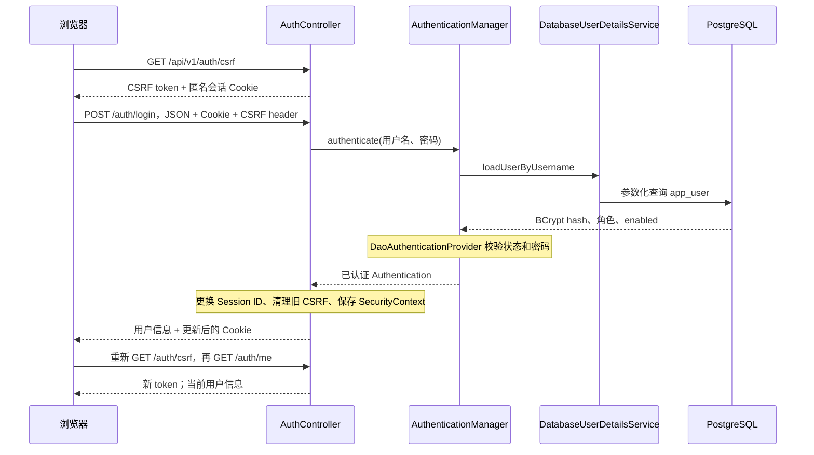

# 登录模块开发指南

这份指南对应当前工程：Java 21、Spring Boot 4.0.8、Spring Security 7、PostgreSQL、Spring JDBC。下面是可以按顺序编写的参考实现，尚未写入 `src/main/java`。先实现登录核心闭环，再按最后的验收项补充限流和完整授权。

## 1. 先理解整个流程



浏览器以后携带 `JSESSIONID`，服务器通过 Session 找到 SecurityContext，再得到 Authentication。用户名密码不需要随每次业务请求提交。浏览器持有的 CSRF token 用来证明写请求来自能读取当前站点响应的页面，它与登录 Cookie 是两个不同值。

Spring Security 7 的自定义认证流程需要显式保存 SecurityContext；手动设置线程里的身份只对当前请求有效。自定义 Controller 登录还需要主动调用 SessionAuthenticationStrategy，落实 Session ID 更换和登录后的 CSRF 轮换。[官方会话说明](https://docs.spring.io/spring-security/reference/7.0/servlet/authentication/session-management.html)、[CSRF 说明](https://docs.spring.io/spring-security/reference/7.0/servlet/exploits/csrf.html)。

## 2. 文件与编写顺序

所有 Java 文件放在 `backend/src/main/java/com/example/aftersales/` 下。每段代码之前的路径是相对于该目录的路径。

| 顺序  | 文件                                       | 你需要理解的内容                         |
| --- | ---------------------------------------- | -------------------------------- |
| 1   | common/ApiResponses.java                 | 成功/失败响应外壳；避免泄露密码和异常内部信息          |
| 2   | security/AppUserRepository.java          | PostgreSQL 查询与参数绑定               |
| 3   | security/DatabaseUserDetailsService.java | 把数据库用户转换为 Spring Security 能识别的用户 |
| 4   | security/SecurityConfig.java             | 认证器、密码算法、会话存储、安全过滤器链与登出          |
| 5   | security/AuthController.java             | CSRF、JSON 登录、当前用户三个入口            |
| 6   | common/ApiExceptionHandler.java          | Controller 参数错误和认证错误的统一响应        |

当前 POM 已有这些代码需要的 Web MVC、Security、Validation、JDBC 依赖。Spring Boot 4 的 JSON 类型使用 `tools.jackson.databind.ObjectMapper`，避免照搬旧版示例中的 Jackson 2 包名。

## 3. 统一响应

文件：`common/ApiResponses.java`

```java
package com.example.aftersales.common;

import jakarta.servlet.http.HttpServletRequest;
import java.util.Map;
import java.util.UUID;

public final class ApiResponses {
    private static final String REQUEST_ID = ApiResponses.class.getName() + ".requestId";

    private ApiResponses() {}

    public static Map<String, Object> ok(Object data, HttpServletRequest request) {
        return Map.of("code", "OK", "message", "success", "data", data,
                "requestId", requestId(request));
    }

    public static Map<String, Object> error(String code, String message,
                                            HttpServletRequest request) {
        return Map.of("code", code, "message", message, "details", Map.of(),
                "requestId", requestId(request));
    }

    private static String requestId(HttpServletRequest request) {
        Object value = request.getAttribute(REQUEST_ID);
        if (value == null) {
            value = UUID.randomUUID().toString();
            request.setAttribute(REQUEST_ID, value);
        }
        return value.toString();
    }
}
```

<mark>这里先保证响应有 requestId；后续公共模块可把它放到请求过滤器和 MDC 中，贯穿日志。`Map` 便于先学认证流程，项目扩大后可换成 `ApiResponse<T>` 和 `ApiError` record。</mark>

## 4. 查询数据库用户

文件：`security/AppUserRepository.java`

```java
package com.example.aftersales.security;

import java.util.Map;
import java.util.Optional;
import java.util.UUID;
import org.springframework.jdbc.core.namedparam.NamedParameterJdbcTemplate;
import org.springframework.stereotype.Repository;

@Repository
public class AppUserRepository {
    private final NamedParameterJdbcTemplate jdbc;

    public AppUserRepository(NamedParameterJdbcTemplate jdbc) {
        this.jdbc = jdbc;
    }

    public Optional<Account> findByUsername(String username) {
        return jdbc.query("""
                SELECT id, username, password_hash, role, enabled
                FROM app_user
                WHERE username = :username
                """, Map.of("username", username), (rs, row) -> new Account(
                    rs.getObject("id", UUID.class), rs.getString("username"),
                    rs.getString("password_hash"), rs.getString("role"),
                    rs.getBoolean("enabled")))
                .stream().findFirst();
    }

    public record Account(UUID id, String username, String passwordHash,
                          String role, boolean enabled) {
        @Override
        public String toString() {
            return "Account[id=" + id + ", username=" + username + ", role=" + role + "]";
        }
    }
}
```

`:username` 的值由 JDBC 绑定，不能改成字符串拼接。`Optional.empty()` 表示没有找到用户。不要把 `Account` 直接返回给前端，它包含密码 hash。这里覆盖 `toString()`，避免调试日志无意打印 hash。

## 5. 接入 Spring Security 的用户加载接口

文件：`security/DatabaseUserDetailsService.java`

```java
package com.example.aftersales.security;

import org.springframework.security.core.userdetails.User;
import org.springframework.security.core.userdetails.UserDetails;
import org.springframework.security.core.userdetails.UserDetailsService;
import org.springframework.security.core.userdetails.UsernameNotFoundException;
import org.springframework.stereotype.Service;

@Service
public class DatabaseUserDetailsService implements UserDetailsService {
    private final AppUserRepository users;

    public DatabaseUserDetailsService(AppUserRepository users) {
        this.users = users;
    }

    @Override
    public UserDetails loadUserByUsername(String username) {
        var account = users.findByUsername(username)
                .orElseThrow(() -> new UsernameNotFoundException("用户不存在"));
        return User.withUsername(account.username())
                .password(account.passwordHash())
                .roles(account.role())
                .disabled(!account.enabled())
                .build();
    }
}
```

这个类负责“加载用户”，密码比较交给 DaoAuthenticationProvider 和 PasswordEncoder。数据库存 `CUSTOMER`，`.roles("CUSTOMER")` 会生成 `ROLE_CUSTOMER` 权限；以后用 `hasRole("CUSTOMER")`。不要自己再补一遍 `ROLE_` 前缀。

BCrypt 每次生成 hash 的随机盐不同，不能重新 `encode(输入密码)` 后用字符串相等比较；认证器会通过 `PasswordEncoder.matches` 校验。当前种子存的是原生 `$2a$...` BCrypt hash，下面显式使用 BCryptPasswordEncoder 与之对应。

## 6. 配置安全过滤器链

文件：`security/SecurityConfig.java`

```java
package com.example.aftersales.security;

import com.example.aftersales.common.ApiResponses;
import jakarta.servlet.http.HttpServletRequest;
import jakarta.servlet.http.HttpServletResponse;
import java.io.IOException;
import java.util.List;
import org.springframework.context.annotation.Bean;
import org.springframework.context.annotation.Configuration;
import org.springframework.http.HttpMethod;
import org.springframework.security.authentication.AnonymousAuthenticationToken;
import org.springframework.security.authentication.AuthenticationManager;
import org.springframework.security.authentication.ProviderManager;
import org.springframework.security.authentication.dao.DaoAuthenticationProvider;
import org.springframework.security.config.annotation.method.configuration.EnableMethodSecurity;
import org.springframework.security.config.annotation.web.builders.HttpSecurity;
import org.springframework.security.config.http.SessionCreationPolicy;
import org.springframework.security.crypto.bcrypt.BCryptPasswordEncoder;
import org.springframework.security.crypto.password.PasswordEncoder;
import org.springframework.security.web.SecurityFilterChain;
import org.springframework.security.web.authentication.session.ChangeSessionIdAuthenticationStrategy;
import org.springframework.security.web.authentication.session.CompositeSessionAuthenticationStrategy;
import org.springframework.security.web.authentication.session.SessionAuthenticationStrategy;
import org.springframework.security.web.context.HttpSessionSecurityContextRepository;
import org.springframework.security.web.context.SecurityContextRepository;
import org.springframework.security.web.csrf.CsrfAuthenticationStrategy;
import org.springframework.security.web.csrf.CsrfException;
import org.springframework.security.web.csrf.HttpSessionCsrfTokenRepository;
import tools.jackson.databind.ObjectMapper;

@Configuration
@EnableMethodSecurity
public class SecurityConfig {
    @Bean
    PasswordEncoder passwordEncoder() {
        return new BCryptPasswordEncoder(10);
    }

    @Bean
    AuthenticationManager authenticationManager(DatabaseUserDetailsService users,
                                                PasswordEncoder encoder) {
        var provider = new DaoAuthenticationProvider(users);
        provider.setPasswordEncoder(encoder);
        return new ProviderManager(provider);
    }

    @Bean
    SecurityContextRepository securityContextRepository() {
        return new HttpSessionSecurityContextRepository();
    }

    @Bean
    HttpSessionCsrfTokenRepository csrfTokenRepository() {
        var repository = new HttpSessionCsrfTokenRepository();
        repository.setHeaderName("X-CSRF-TOKEN");
        return repository;
    }

    @Bean
    SessionAuthenticationStrategy sessionAuthenticationStrategy(
            HttpSessionCsrfTokenRepository csrfRepository) {
        return new CompositeSessionAuthenticationStrategy(List.of(
                new ChangeSessionIdAuthenticationStrategy(),
                new CsrfAuthenticationStrategy(csrfRepository)));
    }

    @Bean
    SecurityFilterChain securityFilterChain(HttpSecurity http,
            SecurityContextRepository contextRepository,
            HttpSessionCsrfTokenRepository csrfRepository,
            ObjectMapper json) throws Exception {
        http
            .csrf(csrf -> csrf.csrfTokenRepository(csrfRepository))
            .securityContext(context -> context
                    .securityContextRepository(contextRepository)
                    .requireExplicitSave(true))
            .sessionManagement(session -> session
                    .sessionCreationPolicy(SessionCreationPolicy.IF_REQUIRED))
            .formLogin(form -> form.disable())
            .httpBasic(basic -> basic.disable())
            .requestCache(cache -> cache.disable())
            .authorizeHttpRequests(auth -> auth
                    .requestMatchers(HttpMethod.GET, "/api/v1/auth/csrf",
                            "/actuator/health").permitAll()
                    .requestMatchers(HttpMethod.POST, "/api/v1/auth/login").permitAll()
                    .requestMatchers("/api/v1/knowledge/**", "/api/v1/evaluations/**")
                            .hasRole("ADMIN")
                    .requestMatchers("/api/v1/**").authenticated()
                    .anyRequest().denyAll())
            .exceptionHandling(errors -> errors
                    .authenticationEntryPoint((request, response, exception) ->
                        writeError(json, request, response, 401,
                                "UNAUTHENTICATED", "请先登录"))
                    .accessDeniedHandler((request, response, exception) -> {
                        boolean csrf = exception instanceof CsrfException;
                        writeError(json, request, response, 403,
                                csrf ? "CSRF_INVALID" : "FORBIDDEN",
                                csrf ? "安全令牌无效，请重新获取" : "没有访问权限");
                    }))
            .logout(logout -> logout
                    .logoutUrl("/api/v1/auth/logout")
                    .invalidateHttpSession(true)
                    .clearAuthentication(true)
                    .deleteCookies("JSESSIONID")
                    .logoutSuccessHandler((request, response, authentication) -> {
                        // LogoutFilter 早于 URL 授权过滤器执行，单独核对之前的登录身份。
                        if (authentication == null
                                || authentication instanceof AnonymousAuthenticationToken) {
                            writeError(json, request, response, 401,
                                    "UNAUTHENTICATED", "请先登录");
                            return;
                        }
                        response.setStatus(HttpServletResponse.SC_NO_CONTENT);
                    }));
        return http.build();
    }

    private static void writeError(ObjectMapper json, HttpServletRequest request,
            HttpServletResponse response, int status, String code,
            String message) throws IOException {
        response.setStatus(status);
        response.setCharacterEncoding("UTF-8");
        response.setContentType("application/json");
        json.writeValue(response.getWriter(), ApiResponses.error(code, message, request));
    }
}
```

这里每个 Bean 的作用：

- `PasswordEncoder`：指定与数据库兼容的 BCrypt 算法。
- `AuthenticationManager`：认证入口；ProviderManager 调用 DaoAuthenticationProvider，后者调用 UserDetailsService 并校验密码。
- `SecurityContextRepository`：保存和恢复 Session 中的登录身份。
- `SessionAuthenticationStrategy`：成功登录后更换 Session ID，清理登录前的 CSRF token。
- `SecurityFilterChain`：请求到 Controller 之前先完成会话恢复、CSRF 检查和路径授权。

`permitAll()` 只放开认证要求，登录 POST 仍然接受 CSRF 检查。过滤器产生的 401/403 不会由普通 ControllerAdvice 统一捕获，所以在这里写 JSON 错误响应。官方还说明了框架登出所清理的会话、安全上下文和 CSRF 状态：[登出指南](https://docs.spring.io/spring-security/reference/7.0/servlet/authentication/logout.html)。

本例只预置知识和评测的 ADMIN 路径限制；其他未来业务路径先要求登录。实现订单、会话、工单接口时，必须继续补上角色校验和 SQL 归属条件，不能把此处的 `authenticated()` 当成完整业务授权。

## 7. 编写 CSRF、登录、当前用户接口

文件：`security/AuthController.java`

```java
package com.example.aftersales.security;

import com.example.aftersales.common.ApiResponses;
import jakarta.servlet.http.HttpServletRequest;
import jakarta.servlet.http.HttpServletResponse;
import jakarta.validation.Valid;
import jakarta.validation.constraints.NotBlank;
import jakarta.validation.constraints.Size;
import java.nio.charset.StandardCharsets;
import java.util.Map;
import java.util.UUID;
import org.springframework.security.authentication.AuthenticationCredentialsNotFoundException;
import org.springframework.security.authentication.AuthenticationManager;
import org.springframework.security.authentication.BadCredentialsException;
import org.springframework.security.authentication.UsernamePasswordAuthenticationToken;
import org.springframework.security.core.Authentication;
import org.springframework.security.core.AuthenticationException;
import org.springframework.security.core.context.SecurityContextHolder;
import org.springframework.security.web.authentication.logout.SecurityContextLogoutHandler;
import org.springframework.security.web.authentication.session.SessionAuthenticationStrategy;
import org.springframework.security.web.context.SecurityContextRepository;
import org.springframework.security.web.csrf.CsrfToken;
import org.springframework.web.bind.annotation.GetMapping;
import org.springframework.web.bind.annotation.PostMapping;
import org.springframework.web.bind.annotation.RequestBody;
import org.springframework.web.bind.annotation.RequestMapping;
import org.springframework.web.bind.annotation.RestController;

@RestController
@RequestMapping("/api/v1/auth")
public class AuthController {
    private final AuthenticationManager authenticationManager;
    private final SessionAuthenticationStrategy sessionStrategy;
    private final SecurityContextRepository contextRepository;
    private final AppUserRepository users;

    public AuthController(AuthenticationManager authenticationManager,
            SessionAuthenticationStrategy sessionStrategy,
            SecurityContextRepository contextRepository, AppUserRepository users) {
        this.authenticationManager = authenticationManager;
        this.sessionStrategy = sessionStrategy;
        this.contextRepository = contextRepository;
        this.users = users;
    }

    @GetMapping("/csrf")
    public Map<String, Object> csrf(CsrfToken csrf, HttpServletRequest request,
                                    HttpServletResponse response) {
        response.setHeader("Cache-Control", "no-store");
        return ApiResponses.ok(new CsrfView(csrf.getHeaderName(), csrf.getToken()), request);
    }

    @PostMapping("/login")
    public Map<String, Object> login(@Valid @RequestBody LoginRequest body,
            HttpServletRequest request, HttpServletResponse response) {
        try {
            // BCrypt 的密码输入有 72 字节上限；不能静默截断后验证。
            if (body.password().getBytes(StandardCharsets.UTF_8).length > 72) {
                throw new BadCredentialsException("Invalid credentials");
            }
            var token = UsernamePasswordAuthenticationToken.unauthenticated(
                    body.username(), body.password());
            Authentication authentication = authenticationManager.authenticate(token);
            UserView user = activeUser(authentication.getName());

            sessionStrategy.onAuthentication(authentication, request, response);
            var context = SecurityContextHolder.createEmptyContext();
            context.setAuthentication(authentication);
            SecurityContextHolder.setContext(context);
            contextRepository.saveContext(context, request, response);

            response.setHeader("Cache-Control", "no-store");
            return ApiResponses.ok(user, request);
        } catch (AuthenticationException exception) {
            // 已登录状态下重新登录失败，也不能残留原账号的成功身份。
            clearLogin(request, response);
            throw exception;
        }
    }

    @GetMapping("/me")
    public Map<String, Object> me(Authentication authentication,
            HttpServletRequest request, HttpServletResponse response) {
        try {
            if (authentication == null) {
                throw new AuthenticationCredentialsNotFoundException("No session");
            }
            response.setHeader("Cache-Control", "no-store");
            return ApiResponses.ok(activeUser(authentication.getName()), request);
        } catch (AuthenticationException exception) {
            clearLogin(request, response);
            throw exception;
        }
    }

    private UserView activeUser(String username) {
        var account = users.findByUsername(username)
                .filter(AppUserRepository.Account::enabled)
                .orElseThrow(() -> new AuthenticationCredentialsNotFoundException("Inactive user"));
        return new UserView(account.id(), account.username(), account.role());
    }

    private void clearLogin(HttpServletRequest request, HttpServletResponse response) {
        new SecurityContextLogoutHandler().logout(request, response,
                SecurityContextHolder.getContext().getAuthentication());
    }

    public record LoginRequest(
            @NotBlank @Size(min = 3, max = 64) String username,
            @NotBlank @Size(min = 8, max = 128) String password) {
        @Override public String toString() { return "LoginRequest[credentials=hidden]"; }
    }
    public record UserView(UUID id, String username, String role) {}
    public record CsrfView(String headerName, String token) {}
}
```

理解登录方法的四步：

1. `authenticate` 验证身份，返回已认证对象；失败抛 AuthenticationException。
2. `sessionStrategy.onAuthentication` 更换原匿名会话的 Session ID，清掉旧 CSRF token。
3. `SecurityContextHolder.setContext` 设置当前请求线程的身份。
4. `contextRepository.saveContext` 保存到 Session，使下一个请求仍然已登录。

UserView 只返回 UUID、用户名、角色。当前实现为便于理解，使用框架内置 User 作为 Principal，再通过可信用户名查询用户 UUID；后续可封装携带 UUID 的自定义 Principal，复用在订单和 Agent ExecutionContext 中。

`@Valid` 会执行 DTO 的字段约束，Jackson 拒绝未知属性的配置已有于 application.yml。不要给 LoginRequest 加客户端传入的 role 或 userId，更不要把 DTO 原文写日志。

BCrypt 的字节上限与接口字段 128 字符上限不是同一概念；这版对超过 72 UTF-8 字节的密码返回认证失败，测试账号是 24 位 ASCII，不受影响。后续增加注册/改密接口时须明确算法与输入上限；如果需要支持更长密码，应统一迁移密码方案。

## 8. 参数和认证异常

文件：`common/ApiExceptionHandler.java`

```java
package com.example.aftersales.common;

import jakarta.servlet.http.HttpServletRequest;
import org.springframework.http.ResponseEntity;
import org.springframework.http.converter.HttpMessageNotReadableException;
import org.springframework.security.authentication.InternalAuthenticationServiceException;
import org.springframework.security.core.AuthenticationException;
import org.springframework.web.bind.MethodArgumentNotValidException;
import org.springframework.web.bind.annotation.ExceptionHandler;
import org.springframework.web.bind.annotation.RestControllerAdvice;

@RestControllerAdvice
public class ApiExceptionHandler {
    @ExceptionHandler({MethodArgumentNotValidException.class,
            HttpMessageNotReadableException.class})
    public ResponseEntity<?> invalidRequest(Exception exception, HttpServletRequest request) {
        return ResponseEntity.badRequest().body(
                ApiResponses.error("VALIDATION_ERROR", "请检查请求字段和格式", request));
    }

    @ExceptionHandler(InternalAuthenticationServiceException.class)
    public ResponseEntity<?> unavailable(InternalAuthenticationServiceException exception,
                                         HttpServletRequest request) {
        return ResponseEntity.status(503).body(
                ApiResponses.error("AUTH_SERVICE_UNAVAILABLE", "认证服务暂不可用", request));
    }

    @ExceptionHandler(AuthenticationException.class)
    public ResponseEntity<?> authenticationFailed(AuthenticationException exception,
                                                  HttpServletRequest request) {
        boolean login = request.getRequestURI().endsWith("/api/v1/auth/login");
        return ResponseEntity.status(401).body(ApiResponses.error(
                login ? "INVALID_CREDENTIALS" : "UNAUTHENTICATED",
                login ? "账号或密码不正确" : "请重新登录", request));
    }
}
```

不存在的用户、错误密码、禁用账号，对外都返回同样的登录失败消息。数据库连接出错不能假装成密码错误，所以认证器内部服务异常单独返回 503。完整公共异常模块后续还应统一处理一般 DataAccessException 和未知 500。

## 9. 启动和手工联调

从 backend 工作目录执行 `mvn spring-boot:run`。当前数据库已有 alice、bob、admin；各自密码在项目的 `data/local/test-accounts.properties`，不要使用 PostgreSQL 管理员密码代替。

| 顺序  | 请求                       | 带什么                                   | 应看到什么                                            |
| --- | ------------------------ | ------------------------------------- | ------------------------------------------------ |
| 1   | GET /api/v1/auth/me      | 无 Cookie                              | 401、UNAUTHENTICATED                              |
| 2   | GET /api/v1/auth/csrf    | 客户端保留 Cookie                          | 200，data.headerName、data.token，匿名 Session Cookie |
| 3   | POST /api/v1/auth/login  | 步骤 2 的 Cookie、X-CSRF-TOKEN、JSON 用户名密码 | 200 用户信息，Session ID 更换                           |
| 4   | GET /api/v1/auth/csrf    | 更新后的 Cookie                           | 200，新登录阶段 token                                  |
| 5   | GET /api/v1/auth/me      | 更新后的 Cookie                           | 当前用户 UUID、username、role                          |
| 6   | POST /api/v1/auth/logout | 更新后的 Cookie 和步骤 4 token               | 204，无响应体                                         |
| 7   | GET /api/v1/auth/me      | 原 Cookie                              | 401                                              |

登录 JSON：

```json
{"username":"alice","password":"从本地账号文件读取对应密码"}
```

Apifox/Postman 启用 Cookie 管理即可；不要在每个请求中手动写死旧 JSESSIONID。所有写请求都要发送 CSRF token；登录成功或失败导致 Session 变化后，重新获取 token。

同源浏览器联调示例。在前端页面控制台执行，密码仅通过本地交互输入，不写进源码：

```javascript
const credentials = "same-origin";
async function getCsrf() {
  const response = await fetch("/api/v1/auth/csrf", { credentials, cache: "no-store" });
  if (!response.ok) throw new Error("无法获取 CSRF token");
  return (await response.json()).data;
}
let csrf = await getCsrf();
const login = await fetch("/api/v1/auth/login", {
  method: "POST", credentials,
  headers: { "Content-Type": "application/json", [csrf.headerName]: csrf.token },
  body: JSON.stringify({ username: "alice", password: prompt("输入 alice 的本地测试密码") })
});
console.log("login", login.status, await login.json());
csrf = await getCsrf();
const me = await fetch("/api/v1/auth/me", { credentials, cache: "no-store" });
console.log("me", me.status, await me.json());
const logout = await fetch("/api/v1/auth/logout", {
  method: "POST", credentials, headers: { [csrf.headerName]: csrf.token }
});
console.log("logout", logout.status); // 204 不调用 response.json()
```

开发前端用 Vite 将 `/api` 代理到 `http://127.0.0.1:8080`，浏览器仍访问前端自己的 `/api`，保持同源调用。HttpOnly Cookie 由浏览器管理，前端脚本不需要读取其值。沿用已有 local/prod 的 Cookie 配置：local HTTP 使用 secure=false，HTTPS 部署使用 secure=true。

## 10. 验收与后续练习

先验证核心功能：

- 无 CSRF 的登录返回 403；有 token 但密码错误返回 401，两种失败不能混淆。
- alice、bob、admin 都能登录，/me 分别返回对应 UUID 与角色，不返回密码/hash。
- 登录前后 Session ID 变化；丢失 Cookie 后 /me 返回 401。
- 登出后 /me 返回 401；204 响应没有 body。
- alice 已登录时，再提交错误密码，不应继续保留 alice 的登录身份。
- /me 会重新检查 enabled；禁用账号后请求 /me 应清理登录并返回 401。
- 非管理员访问知识/评测路径被拒绝；有相应权限但业务 Controller 尚未编写时返回 404 并不表示认证失败。
- 不能从响应或日志中读到密码、hash、Cookie、CSRF token。

再完成需求中的剩余安全功能：登录限流（单实例可采用有容量和过期时间的本地限流器，返回 429，多实例再用 Redis）、角色与资源归属授权、禁用/改角色时使已有会话失效。当前 /me 的 enabled 检查不会自动检查其他业务请求；要实现全局禁用效果，需要每个受保护请求统一重验或主动注销该用户的全部会话。

建议用 MockMvc + spring-security-test 验证匿名/已登录、CSRF、登录持久化、登出与角色差异。CSRF 流程测试要先调用真实 /csrf 取得 token 和会话，再登录、重新取 token、登出；单独用 `.with(csrf())` 不能覆盖 token 轮换和 Cookie 持久化。

可做三个学习实验：暂时漏掉 saveContext，观察登录返回成功但下一次 /me 为 401；换浏览器/清除 Cookie，观察 Session 识别变化；分别用 alice 和 bob 的会话访问将来实现的订单接口，验证 SQL 必须带当前用户条件。每次实验后恢复正确实现。

2026-10-14 验证记录：已从本文提取全部六份 Java 示例，在 JDK 21、Spring Framework 7.0.9、Spring Security 7.0.7、Jackson 3.1.5、Servlet 6.1 依赖下通过 javac 编译。编译输出位于被忽略的 backend/target/login-guide-validation，示例尚未写入业务源码；真实浏览器、数据库和 HTTP 完整联调需在实现后按上述步骤执行。
